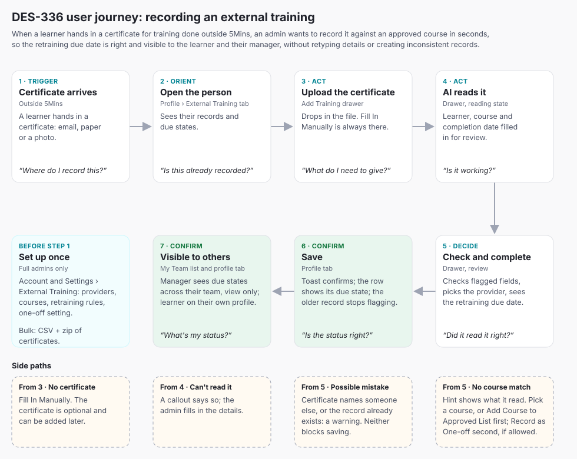

# DES-336: External training improvements - approved list, recording flow, profile tabs

**Ticket:** DES-336 (In Design Phase) · **Epic:** DEV-4739 (DEV Sprint 115) · **Stories:** DEV-4740, DEV-4741, DEV-4742, DEV-4743 · **Owner:** Bruno Carvalho · **Date:** 2026-11-05
**Prototype:** https://claude.ai/code/artifact/3c75ae0e-7eda-4718-ac22-2fe456b489b0 (behaviour reference) · **Help article:** [External training records](https://help.5mins.ai/articles/1886875-external-training-records) · **Full evidence:** `2026-11-05-DES-336-external-training-improvements.research.md`

---

## 1. Context

### The problem

External training data can't be trusted. Admins type the course and provider as free text, so one training splits into many spellings, and they work out expiry dates by hand, so nobody can reliably say who is overdue. Managers can't see external training at all, and it isn't on a person's profile.

**Table stakes:** recording external training with a certificate and an expiry date (Cornerstone, Docebo, SafetyCulture, 7shifts), and a catalogue with refresher rules (Mapal Flow, which our customers come from). **Novel:** a certificate-first drawer where AI reads the certificate and matches it to the approved list, without letting free text back in. Workday, by contrast, can't apply expiration rules to external learning at all (research section 2).

### What the code does today

| File | Today | Change |
|---|---|---|
| `src/pages/learning-records/LearningRecords.tsx` | `/learning-records`, External Training tab: page-local `externalData: ExternalRecord[]` with free-text `training` and `provider`, an `expiration` column, disabled Download and kebab. No Add Training button | Add Training menu moves here; Retraining due column with badges; working row actions |
| `src/pages/my-team/LearningRecordsTab.tsx` | My Team (manager, learner chrome): External Training view has an **Add Training** menu (Add training, Bulk upload CSV disabled) | Add actions removed; read-only list gains Retraining due column, badges and filter (D22, 3.6) |
| `src/pages/my-team/AddTrainingDrawer.tsx` | Free-text email, training, provider; `InputField type="date"`; hand-rolled steppers; `FileUploader` last | Rebuilt as the certificate-first drawer |
| `src/pages/account/Account.tsx` | `TABS` (Layout, Audit Log, ... Hugo AI, Content Access), page-local `.acs-tab` bar, `?tab=` deep link | New `external-training` tab |
| `src/pages/user-profile/UserProfile.tsx` | `/people/:id` (admin) and `/my-team/people/:id` (manager, `isLearnerView`). `TABS` Engagement, Skills, Course Progress, Certificates; only Course Progress is live. Looks up `PEOPLE[id] ?? teamProfiles[id]` | New External Training tab; manager team guard |
| `src/pages/my-team/MyTeam.tsx` | `learnerSideItems` "Profile" and "My Progress" have no `path` | "Profile" links to the learner's own `UserProfile` (3.5) |
| `src/pages/people/components/BulkUploadModal/` | Upload → preview → success, error chips, error file | Pattern for both CSV uploads |
| `src/data/` | No external training store | New `externalTraining.ts` |

### Decisions taken

| # | Decision | Reason |
|---|---|---|
| D1 | The approved list lives in **Account and Settings, new External Training tab** | Set up once, like other tenant configuration |
| D2 | **Provider = name only.** A provider has many courses; a course can have several providers; the admin picks the provider when recording | Matches reality without duplicate courses |
| D3 | **Course = name, one or more providers, duration, retraining rule** (No retraining, or every N months) | Everything a record needs comes from the list |
| D4 | Providers and courses **with records are archived, not deleted**; unused ones can be deleted. Archived ones aren't offered for new records or uploads; their records stay | Never orphans compliance history (replaces DEV-4740's delete-with-cascade AC) |
| D5 | **One-offs:** a tenant setting allows them, **on by default**. The Add training drawer also lets the admin add a not-yet-listed course to the approved list, then record it. With the setting off, only approved courses can be recorded, including via CSV | Ticket model, plus a route that keeps data clean |
| D6 | **Add training starts with uploading the certificate.** AI pre-fills learner, completion date and best matching approved course, flagged for the admin to check. With no confident match, the course stays empty with the text it read shown as a hint; the admin picks or adds the course | Fast, and AI never brings free text back |
| D7 | If the certificate **can't be read**, the admin fills in the form manually | Never a dead end |
| D8 | If the certificate names a **different learner** from the one already selected (profile tab), an Alert says so, following DS conventions. **Saving waits for a choice** (updated 2026-11-09): the admin ticks "Brenda Kwasaki is the person named on this certificate" under the Learner field or swaps the file (Change File beside the certificate). Pressing Add Training first takes them to the box. Changing the learner or the file asks again | Catches the wrong certificate on the wrong person, without a dead end when the name legitimately differs (married name, nickname, a misread) |
| D9 | **Retraining due date** = completion date + course rule, shown before saving, stored on the record. Editing a course's rule only affects new records | Protects past records |
| D10 | **Overdue / Due soon** show on the **latest record** of any course with a retraining rule; older records for the same person and course are superseded and never flag. **Due soon = due within 90 days** | 5Mins has no role-to-course requirements to scope it further |
| D11 | **CSV bulk upload stays**, accepts a **zip of certificates**, matches rows to the approved list and tells the admin which providers and courses already exist | Bulk recording with certificates, no duplicates |
| D12 | **Admin:** External Training tab on the person profile (add, edit, delete; learner pre-selected). **Manager:** same tab under My Team, view-only, own team only | DEV-4742, DEV-4743 |
| D13 | **One External Training tab on the existing `UserProfile`**, shared across roles: admins add, edit and delete; managers (own team only) and the learner on their own profile view only. No new route | Learners see their own status; one page to build |
| D14 | **Upload first, "Fill In Manually" always visible** from the start, not only after a failed read | Expensify-style escape; certificate is optional (D17) |
| D15 | **CSV spelling variants are matched inside the upload.** The preview lists names that don't match an approved course; the admin maps each once, and the choice is remembered as an other name on the course, so later uploads match automatically. No other-names field to maintain in Settings; remembered names show read-only on the course, removable | Keeps uploads working with one-offs off, with nothing extra to set up |
| D16 | **One retraining rule per course.** Per-department intervals are a follow-up | Smallest model that covers the job |
| D17 | **Certificate is optional to save.** Records without one show "–"; it can be added later by editing | Matches today's product; never blocks recording |
| D18 | **Not Passed records get no retraining due date and never flag.** The latest passed record is the one that counts | A failed attempt doesn't renew anything |
| D19 | **Renaming a course renames it on past records** (records point at the course); the certificate file keeps its original wording | One name for reporting |
| D20 | **Records on an archived course keep showing Overdue and Due soon** | Archiving stops new records, not compliance tracking |
| D21 | **Only full admins** manage the approved list and the one-off setting. Limited admins (DES-308) record trainings for people in their scope but can't edit the list, so "Add Course to Approved List" is hidden for them | List stays clean and owned |
| D22 | **Managers keep the My Team > Learning Records > External Training list**, read-only, with the Retraining due column, Overdue / Due soon badges and a due-state filter | Answers "who in my team is due?" without opening every profile (UX audit F1) |
| D23 | **No-match order:** "Add Course to Approved List" first, "Record as One-off" second. When the approved list is empty, a Callout steers the admin to add the course to the list | Stops free text coming back on day one (F2) |
| D24 | **Add Training sits in the External Training tab's own toolbar**, admins only, not in the person header | Keeps page-level and tab-level actions apart (F3) |
| D25 | **Duplicate warning:** the drawer warns, without blocking, when the same learner, course and completion date already exist. The CSV and one-off rules stay as they are | Certificates often arrive twice (F5) |
| D26 | **Invited people** (not yet registered) appear in the Add Training learner list; their records show on their profile once they join | Today's records can exist before registration (F10) |

Assumptions this PRD makes (flagged, not decided): course **status** in the ticket means Active or Archived (no ON/OFF toggle, since seeding is out of scope); a course's providers are picked from the provider list, with "Add Provider" for a new one.

### The user journey

**Job:** When a learner hands in a certificate for training done outside 5Mins, an admin wants to record it against an approved course in seconds, so the retraining due date is right and visible to the learner and their manager, without retyping details or creating inconsistent records.

Claude Design: https://claude.ai/artifact/CwiSJUW2HDqZtVuMZmXA4D

1. **Trigger** - A learner hands in a certificate (email, paper, photo). *Outside 5Mins.*
2. **Orient** - The admin opens the person's profile, External Training tab, and sees what's recorded and what's due. *Person profile.* (Or Learning Records > External Training.)
3. **Act** - Add Training opens the drawer; the admin drops in the certificate. *Add training drawer, upload.*
4. **Act** - AI reads it and fills learner, course and completion date. *Drawer, reading state.*
5. **Decide** - The admin checks the flagged details, picks the provider if the course has several, and sees the calculated retraining due date. *Drawer, review.* Side paths from here: no course match (add to the approved list first, one-off second); unreadable certificate (fill in manually); **wrong learner or duplicate** (an Alert names the other person and saving waits until the admin ticks a box confirming it is the same person, or changes the file; or a Callout says the same record already exists, which doesn't block saving).
6. **Confirm** - Add Training saves; a toast confirms and the row shows its due state. *Profile tab.*
7. **Confirm** - The manager sees it, view-only, in the My Team list with due states and on the team member's profile; the learner sees it on their own profile. *My Team > Learning Records > External Training, and the External Training tab on `UserProfile`.*

Set-up, done once before step 1: the admin builds the approved list in *Account and Settings > External Training*.

### Acceptance criteria

**Epic DEV-4739**
- E1. Admins manage an approved list of external training providers and courses; each course carries a duration and a retraining rule
- E2. Recording an approved training needs only the learner, course, completion date and certificate; the retraining due date is calculated automatically
- E3. A tenant setting controls whether one-off trainings (not on the approved list) can be recorded
- E4. A person's external trainings can be viewed and managed from their profile by admins
- E5. Managers can view, but not edit, the external trainings of their team members

**DEV-4740: Manage approved providers and courses**
- A1. Account and Settings has a new External Training tab showing the approved providers and approved courses
- A2. Admins can add, edit and delete providers; a provider is a name only
- A3. Admins can add, edit and delete courses; each course has a name, ~~one of the approved providers~~, a duration, and a retraining rule (not required, or required every N months). **Superseded by D2-D3:** one or more approved providers.
- A4. Duplicate provider names, and duplicate course names under the same provider, are rejected with a clear message. *Note under D2: a duplicate course is the same name sharing any provider.*
- A5. ~~Deleting a provider also removes its courses, after a confirmation that says so; existing training records on people are unaffected.~~ **Superseded by D4:** used providers and courses are archived; only unused ones are deleted. Records are never affected.
- A6. The tab has a setting to allow or disallow one-off entries (trainings not on the approved list), defaulting to allowed

**DEV-4741: Record in one step with auto-calculated retraining date**
- B1. When adding a training, approved courses are suggested first in the course search; selecting one fills in the provider and duration automatically
- B2. The retraining due date is calculated from the completion date and the course's retraining rule, shown before saving, and stored on the record
- B3. The external trainings table shows the retraining due date, with overdue records clearly flagged
- B4. When one-off entries are allowed, a training not on the approved list can still be recorded with a manually entered provider, duration and optional retraining due date
- B5. When one-off entries are disallowed, only approved courses can be recorded, including through the bulk CSV upload

**DEV-4742: External Training tab on the person profile**
- C1. The person profile has an External Training tab listing that person's trainings with completion date, retraining due date, duration, result and certificate download
- C2. Admins can add a training from this tab with the learner pre-selected and not changeable
- C3. Admins can edit and delete records from this tab
- C4. A clear empty state is shown when the person has no external trainings

**DEV-4743: Managers view their team's external trainings**
- M1. The team member profile under My Team has an External Training tab
- M2. The tab is view-only: no add, edit or delete actions
- M3. Managers see the same record details as admins, including certificate download
- M4. Managers can only see this for their own team members

Not in any AC, added by the plan: AI pre-fill (D6-D8), certificates zip and name matching (D11, D15), learner view (D13), limited admin access (D21), manager team list (D22), duplicate warning (D25), invited people (D26). The Jira ACs for A3 and A5 need updating to match D2-D4.

### Out of scope

Seeding the approved list from existing records (Needs review flag, first-visit banner); learners or managers submitting external trainings; mapping external trainings to skills or competency profiles (skill passport); role-to-course requirements; per-department retraining intervals; notifications for Due soon or Overdue beyond the existing Automate Reports.

---

## 2. Research

Only rows that drove a decision are listed. Quotes and every source are in the research file. Sana Labs had nothing usable: its "external training" pages cover training customers and partners, and its help centre only covers manual completion of Sana courses.

### Approved catalogue and retraining

| Source | What it does | Verdict |
|---|---|---|
| [Mapal Flow: External Training](https://help.mapal-os.com/flow-learning/learning-and-development/external-training/introduction-to-external-training/) | Catalogue of external items with provider, refresher rules shared with internal training, archive to keep it current | Adopt: catalogue + archive (D1, D4) |
| [Mapal: refresher rules](https://help.mapal-os.com/flow-learning/learning-and-development/landd-settings/refresher-l-d-settings/add-and-edit-refresher-rules/) | Rule changes apply from the day they're added | Adopt (D9) |
| [Docebo: external training certifications](https://help.docebo.com/hc/en-us/articles/360020083240) | Completion date becomes issue date; expiry by custom interval | Adopt completion date as the base; months only |
| [Docebo community: renewals](https://community.docebo.com/product-q-a-7/renewals-and-certification-4622) | Renewal archives the previous certificate | Adopt: latest record supersedes (D10) |
| [Workday Learning admin guide](https://doc.workday.com/admin-guide/en-us/human-capital-management/learning/learning-content/usx1517492748668.html) | External content can't use expiration rules | Confirms calculated retraining is a differentiator |
| [5Mins help: Automate Reports](https://help.5mins.ai/articles/1886875-external-training-records) | Expiry report look-ahead defaults to 3 months | Supports Due soon = 90 days (D10) |

### Recording and the certificate

| Source | What it does | Verdict |
|---|---|---|
| SafetyCulture credentials ([004559](https://help.safetyculture.com/004559)) | Media required by default, but admins can "Make media optional" | Adopt: certificate optional to save (D17) |
| [Mapal: upload supporting documents](https://help.mapal-os.com/flow-learning/learning-and-development/external-training/upload-supporting-documents-for-an-external-training/) | Certificate added to an existing record later | Same |
| [Schoox: reassignment after manual completion](https://sigmasupport.schoox.com/hc/en-us/articles/35746619812247-Understanding-Immediate-Course-Reassignment-After-Manual-Completion) | Backdated completions create already-expired records | Show the due state in the drawer before saving (2.5) |

### AI reading the certificate

| Source | What it does | Verdict |
|---|---|---|
| [Mercury expense](https://mobbin.com/screens/739e3947-628e-4a2c-8f32-b31114a3df5b) | Drop zone first: "We can pull your transaction details automatically" | Adopt: upload first (D6) |
| [Expensify SmartScan](https://mobbin.com/screens/7ac3095f-78b8-43f8-8cfe-0a686ffea815) | "Fill out the details myself" while scanning | Adopt: manual escape always visible (D7, D14) |
| [Acctual new bill](https://mobbin.com/screens/b812e034-b340-4c0d-b7ee-41d556ea1f07) | "Scanning your invoice to auto-fill the details" banner | Adopt: `AIWorkingCard` single line |
| [QuickBooks uploaded receipt](https://mobbin.com/screens/13555932-4086-4811-a214-0deccbce373d) | "Double-check the details and add any missing info." | Adopt: one Callout flags the filled fields |
| [Deel add items](https://mobbin.com/screens/10d935d5-f3f8-448b-8bb5-0c7195e61ed4) | Unmatched fields left empty | Adopt: empty course on no match (D6) |

### Picking or adding a course

| Source | What it does | Verdict |
|---|---|---|
| [Melio add vendor](https://mobbin.com/screens/22b6930f-3b4a-421f-9b67-e53578b97a26), [Bonsai new project](https://mobbin.com/screens/c7bbb8d9-25a5-4b69-823d-d7ca93eb7ac8) | "Add new" row inside the select | Adopt the idea as a button under the field; `Dropdown` has no footer row |
| [folk no results](https://mobbin.com/screens/88bfa6c2-d2a2-4b42-9f86-0d8bf29a02fd) | `Create "alex"` carries the typed text | Adopt: read text pre-fills the new course name |

### Bulk import and expiry tables

| Source | What it does | Verdict |
|---|---|---|
| [Customer.io import review](https://mobbin.com/screens/ea216cbe-fc77-4dd1-ae77-66bb8f2bce1b) | New / existing / errors counts, error file | Adopt (2.6, 1.6) |
| [Fresha preview](https://mobbin.com/screens/2d5e41af-fe36-493e-a2e3-0e1b0306d8a0) | "To be imported" / "Errors" with reasons | Adopt as Chip filters (no nested tabs) |
| [Attio review values](https://mobbin.com/screens/60a1cfe5-3788-49e3-b3ae-3da62a33f7ee) | Map unknown values once, inline | Adopt: match step in the CSV preview (D15) |
| [7shifts certifications](https://mobbin.com/screens/806539a9-f62a-44fd-aad4-db4283e65b31), [Vanta tests](https://mobbin.com/screens/eb1d71b4-2b3c-4a83-8435-bdc0e7cbb9e2) | Expiry date with status; "Overdue" and "Due soon" naming | Adopt badge + date; no "Valid" badge for upcoming |

### Mobbin

Searched by interaction: document upload that fills a form; CSV import review; certifications table with expiry status; searchable select with "create new". Results are cited in the tables above; the side-by-side document preview (QuickBooks, Deel, Acctual) is rejected because the 720px drawer can't hold it; `FileUploader`'s Preview opens the file instead.

### Build For Mars

| Lesson | Verdict |
|---|---|
| [Wise: upload an invoice](https://builtformars.com/ux-bites/upload-an-invoice): say what the file must contain; "We use AI to process your document. Please check the results." | Upload hint and review Callout (2.2, 2.3) |
| [Monzo: incorrect recipient details](https://builtformars.com/ux-bites/incorrect-recipient-details): name the exact mismatch | Mismatch Alert names both people (2.4) |
| [Slack: catching common typos](https://builtformars.com/ux-bites/catching-common-typos): warn, let the user carry on | Mismatch never dead-ends: ticking the confirm box carries on (updated 2026-11-09) |
| [Substack's danger zone](https://builtformars.com/ux-bites/highway-to-the-danger-zone), [intentional friction](https://builtformars.com/ux-glossary/intentional-friction): state exactly what is lost | Delete dialog names the item; Archive is lighter and reversible (1.4) |

---

## 3. Implementation

### Blockers

1. **No AI extraction service exists in the product.** Certificates hold personal data. *Decision:* the model, data processing and retention are decided in production and don't affect the prototype; the AI pre-fill is not controlled by the Hugo AI setting. Build the manual drawer first (2.1) so recording works without AI. Not blocking any AC: AI isn't in the ACs.
2. **Manager scope isn't enforced.** `/my-team/people/:id` resolves any person. *Recommendation:* the External Training tab under `/my-team` renders for ids in `teamProfiles` or the signed-in learner's own id; otherwise the page shows "You can only see people in your team." Production enforces it in the API. Needed for **M4**.
3. **`Dropdown` has no "add new" row** in its menu. *Recommendation:* "Add Course to Approved List" and "Record as One-off" as text buttons under the course field, in that order (D23). No new component.
4. **Jira ACs A3 and A5 contradict D2-D4.** *Recommendation:* Bruno updates both stories (append, don't overwrite). Note only; Jira not edited.

No AC is unbuildable.

### Data (`src/data/externalTraining.ts`)

- `ExternalProvider { id, name, archived }`
- `ExternalCourse { id, name, providerIds: string[], duration: { value, unit: 'minutes' | 'hours' | 'days' }, retrainingMonths: number | null, otherNames: string[], archived }` (`otherNames` only filled by the CSV match step, D15)
- `ExternalRecord { id, personId, courseId | null, oneOff?: { name, provider, duration }, providerId | null, completionDate, retrainingDueDate | null, result, score | null, certificate | null, source: 'manual' | 'ai' | 'csv' }`
- `allowOneOffs: boolean` (default `true`)
- Not Passed records store no `retrainingDueDate` (D18). Records show the course's current name (D19).
- `dueState(record, allRecords)`: `null` if no due date or superseded (a newer **passed** completion for the same person and course, or the same one-off name); `'overdue'` if before today; `'due-soon'` within 90 days; otherwise `'upcoming'`. The course's archived flag is ignored (D20).
- Permissions: full admins edit the list and setting; limited admins record for people in scope (D21).
- Due date: add N calendar months to the completion date; clamp to the month's last day (31 Jan + 1 month = 28 Feb).
- Today's `externalData` rows become one-off records keeping their `expiration` as the due date.

### Phases

**Phase 1: approved list (DEV-4740)**

| # | Change | Components | Verify | AC / step |
|---|---|---|---|---|
| 1.1 | **External Training tab** in `Account.tsx` `TABS`, after Audit Log, `?tab=external-training`. Three stacked sections: setting, Approved courses, Approved providers | Existing `.acs-tab` bar (no shared Tabs component), section titles per `headers.md` | Deep link opens the tab | A1, E1, set-up |
| 1.2 | **One-off setting.** Toggle "Allow one-off trainings", helper "Admins can record training that isn't on the approved list. Turn this off to only allow approved courses." Applies instantly, toast "One-off trainings turned off" / "turned on" | `Toggle` (settings, amber, not `live`), `Toast` | Default on; drawer and CSV follow it | A6, E3, B5 |
| 1.3 | **Courses table**: Course, Providers, Duration, Retraining ("Every 12 months" / "No retraining"), Records. `Search` "Search courses". Toggle "Show archived"; archived rows use `getRowState` `'disabled'` with an Informative Badge "Archived". Header buttons: Upload CSV (outlined-2), Add Course | `Table`, `Search`, `Toggle`, `Badge`, `Button` | Archived hidden by default | A1, A3 |
| 1.4 | **Row actions.** Edit; Archive (if records) or Delete (if none); Unarchive. Archive dialog: "Archive First Aid at Work?", "It won't be offered for new records or uploads. Its 14 records stay on people's profiles and still show when they're due." Cancel / Archive Course. Delete dialog (`semantic="danger"`): "Delete First Aid at Work?", "It has no records. It's removed from the approved list and can't be recovered." Cancel / Delete Course. Toasts "First Aid at Work archived" / "deleted" | `RowActionsMenu` (danger item last), `ConfirmModal` (no X) | Delete never offered when records exist | A3, A5 (superseded), D4 |
| 1.5 | **Course drawer** (Add Course / Edit Course, 720px): Course name; Providers (multi-select, searchable) with "Add Provider" text button; Duration (number + unit); Retraining: Radio "No retraining" / "Every [12] months". Editing the rule on a course with records shows Callout "Changes apply to new records only. The 14 existing records keep their retraining due dates." Errors on Save: "Add a course name", "Add at least one provider", "Add a duration", "There's already a course called First Aid at Work with St John Ambulance." Renaming a course with records: Callout "The new name shows on its 14 records too. Certificate files keep their original wording." If the course has remembered names (D15), a read-only "Also matches in uploads" list shows each as a removable Badge. Save Course; toast "First Aid at Work added". The tab, setting and every edit control show only to full admins (D21) | Page-local drawer shell + `useOverlayA11y`, `InputField`, `Dropdown multiple searchable`, `InputInteger`, `Dropdown`, `Radio`, `Alert type="Callout"`, `Badge` with `onDismiss` | Can't save without duration and rule; duplicate rejected; limited admin can't reach the tab | A3, A4, D3, D9, D19, D21 |
| 1.6 | **Providers table**: Provider, Courses, Records; same actions and dialogs as 1.4. **Add Provider** opens a small modal: Provider name, Save Provider; error "There's already a provider called NEBOSH." Archiving a provider that is a course's only active provider: "First Aid at Work has no other provider, so it can't be recorded until you add one." | `Table`, `ConfirmModal closable`, `InputField` | Duplicate names rejected, case-insensitive | A2, A4, D4 |
| 1.7 | **Approved list CSV**: Download Template; columns Course name, Providers (separated by ";"), Duration, Duration unit, Retraining every (months, blank = No retraining). Preview with Chip filters: Ready to add, Already in your list (skipped, never overwritten), Errors (with reason and error file). New providers named in the file are created. Commit "Add 12 Courses" | `BulkUploadModal` pattern, `FileUploader`, `Chip`, `Table`, `Toast` | Re-uploading the same file adds nothing | E1, ticket CSV item |
| 1.8 | **Empty states.** Courses: "No approved courses yet", "Add the external courses your people take, with how often they need retraining.", Upload CSV / Add Course. Providers: "No approved providers yet", Add Provider | `EmptyState`, `empty-box.svg` | Shown in place of rows | A1 |

**Phase 2: recording (DEV-4741)**

| # | Change | Components | Verify | AC / step |
|---|---|---|---|---|
| 2.1 | **Drawer rebuild** ("Add external training", 720px). Order: Certificate, Learner, Course, Provider, Completion date, Retraining due, Result and score (optional). Duration shows read-only under the course. Footer: Add Training. Learner field: searchable people `Dropdown`, including invited people with description "Invited" (D26); on a profile it's read-only with the person's name. Limited admins see only people in their scope | `FileUploader size="L"`, `Dropdown searchable`, `DatePickerField` (`maxDate` today, `ariaLabel="Completion date"`), `Radio`, `InputInteger` | Saves with learner, course and date; certificate optional (D17) | B1, E2, D21, step 3 |
| 2.2 | **Upload first.** Label "Certificate (PDF, JPG, PNG • max. 10MB)", hint "Upload the certificate and we'll fill in the details from it." A **Fill In Manually** text button sits under the uploader from the start and stays visible while reading | `FileUploader`, `Button variant="text"` | Manual path never needs a file | D6, D7, D14, D17, step 3 |
| 2.3 | **Reading and review.** While reading: "Reading the certificate..." Fields stay editable. When done, Callout "We filled in these details from the certificate. Check them before you save." | `AIWorkingCard singleLine`, `Alert type="Callout"` | Admin can edit every filled field | D6, step 4-5 |
| 2.4 | **Branches.** *No match:* course empty, helper "The certificate says “Food Hyg L2”. Pick the matching course, or add it to the approved list." *Unreadable:* Callout "We couldn't read this certificate. Fill in the details below." *Learner mismatch* (profile or learner already picked): no Alert; the Learner field shows the error "The certificate names Paul Whitaker." with a Checkbox below it, "Sarah Chen is the person named on this certificate". Ticked, the error line goes and nothing replaces it; the ticked box is the confirmation. Saving waits until the box is ticked or the file changes; pressing Add Training before that scrolls to and focuses the box. If the certificate names someone not in 5Mins (no learner picked), the field error reads "The certificate names Paul Whitaker, who isn't in 5Mins. Pick a learner or change the file." (updated 2026-11-09, D8). *Duplicate* (same learner, course and completion date exist, D25): Callout "Sarah Chen already has First Aid at Work completed on 14 Oct 2026." with text button Edit Existing Record; saving isn't blocked | `Dropdown` `helperText`, `Alert type="Alert"` with `Danger` Bold `customIcon`, `Alert type="Callout"` | Each branch reachable with a demo file; the duplicate warning never blocks Add Training; the mismatch unblocks when the confirm box is ticked | D6-D8, D25, step 5 |
| 2.5 | **Course and due date.** Approved active courses only, matching name; the course's provider fills in (Radio if several). Retraining due line: "Retraining due 14 Oct 2029", or "No retraining" (same wording as Settings); if already past or within 90 days, the Overdue / Due soon Badge shows beside it. Result Not Passed: "No retraining due date for a training that wasn't passed." | `Dropdown searchable`, `Radio`, `Badge` | Date matches the clamp rule; Not Passed stores no date | B1, B2, D9, D18, step 5 |
| 2.6 | **Not on the list (D23).** Under the course field, in this order: **Add Course to Approved List** (first; hidden for limited admins, D21) opens the course fields inline (Collapse) with the typed or read name, then selects it; **Record as One-off** (second, only if allowed) reveals Training name, Provider name, Duration, Retraining due date (optional). When the approved list is empty and one-offs are on: Callout "Your approved list is empty. Add this course to it to keep records consistent." | `Collapse`, `InputField`, `InputInteger`, `DatePickerField`, `Alert type="Callout"` | Setting off hides Record as One-off; limited admin never sees Add Course | B4, B5, D5, D21, D23 |
| 2.7 | **No courses and one-offs off.** Drawer body shows "No approved courses yet", "Add courses to the approved list in Account and Settings before recording training.", Go to Settings | `EmptyState` | Shown only in that combination | Ticket empty state, B5 |
| 2.8 | **Save.** Toast "First Aid at Work added for Sarah Chen". Row appears; superseded older row stops flagging | `Toast` | Learning Records and profile both show it | B2, step 6 |
| 2.9 | **Learning Records.** `LearningRecords.tsx` gains the Add Training menu (Add Training, Bulk Upload CSV). Columns: Learner, Course, Provider, Completion date, Retraining due (date, Badge Warning "Due soon" or Error "Overdue"; superseded rows add supporting text "Renewed 12 Mar 2026"), Duration, Result, Certificate. One-off rows show Informative Badge "One-off". Working Download and row actions (Edit, Delete). `FilterBar` gains Retraining: Overdue, Due soon | `Table`, `Badge`, `RowActionsMenu`, `FilterBar` | Overdue rows filterable | B3, D10 |
| 2.10 | **Records CSV + zip.** Two uploaders: CSV, Certificates zip (optional). Preview sections: People matched by email; Training matched to the approved list, including remembered names; Certificates matched by file name (rows without one are added with "–"); Already in 5Mins (same person, course, completion date: skipped); New. Chip filters, error file, commit "Add 46 Records". Limited admins: rows outside their scope are errors | `BulkUploadModal` pattern, two `FileUploader`, `Chip`, `Table` | One-offs off: no unlisted row is added | B5, D11, D17, D21 |
| 2.11 | **Match step (D15).** "Names that aren't on your approved list": one row per distinct name with its row count ("Forklift CB 3 day · 2 rows") and a searchable Dropdown "Match to course", plus "Record as one-off" (if allowed) or "Skip these rows". Helper: "We'll remember this, so next time these rows match on their own." Saved on commit as the course's other name | `Dropdown searchable` per row, `Table` | Re-uploading the file needs no matching | B5, D15 |

**Phase 3: profile tabs (DEV-4742, DEV-4743, learner)**

| # | Change | Components | Verify | AC / step |
|---|---|---|---|---|
| 3.1 | **One shared tab** "External Training" after Certificates in `UserProfile.tsx` (D13); the viewer's role decides the controls. Admin view: Columns: Course, Provider, Completion date, Retraining due, Duration, Result, Certificate (Download), actions. Sorted Overdue, Due soon, then newest. **Add Training** (Outlined-2) on the right of the tab's own toolbar above the table, admins only, hidden in the empty state (D24); not in the person header. It opens 2.1 with the learner locked | `Table`, `RowActionsMenu`, `Badge`, `Button` | Learner can't be changed; button absent on other tabs and for managers and learners | C1, C2, E4, D24, step 2 |
| 3.2 | **Edit and delete.** Edit opens the drawer filled, "Edit external training", Save Changes; changing the date recalculates the due date; a missing certificate can be added here (D17). Delete: "Delete First Aid at Work from Sarah Chen's profile?", "The record and its certificate are removed and can't be recovered." Cancel / Delete Record | Drawer, `ConfirmModal semantic="danger"` | Delete updates due states | C3 |
| 3.3 | **Empty state.** Admin: "No external training yet", "Record training Sarah has done outside 5Mins to track when it's due again.", Add Training. Manager and learner: same title, no button, "Your admin records training done outside 5Mins from the certificate." | `EmptyState`, `certificates.svg` | Correct variant per viewer | C4 |
| 3.4 | **Manager** (`/my-team/people/:id`): same tab and columns including Download; no Add, no actions column. Team guard per Blocker 2 | As 3.1, read-only | No edit control reachable by keyboard | M1-M4, E5, step 7 |
| 3.5 | **Learner** on their own `UserProfile` (learner chrome, `/my-team/people/:id` with their own id): same tab, read-only, sentence "Training you've done outside 5Mins. Your admin records it from your certificate." Small wiring step: the learner sidebar "Profile" item in `learnerSideItems` gets a `path` to the signed-in person's profile | As 3.4 | Learner sees own records only; wording matches the empty state | D13, step 7 |
| 3.6 | **My Team list (D22).** `LearningRecordsTab.tsx` External Training view: Add Training menu removed; read-only columns Learner, Course, Provider, Completion date, Retraining due (same badges and "Renewed" line as 2.9), Result, Certificate (Download); no actions. Due-state filter: `Dropdown` "Retraining" with All, Overdue, Due soon. Same `dueState` as admin. Own team only | `Table`, `Badge`, `Dropdown` | Manager filters to Overdue and sees only their team; no add or edit control | M2-M4, E5, D22, step 7 |

### Risks to watch during build

- **AI confidence.** A wrong but plausible course match is worse than none; only pre-fill above a confidence threshold engineering sets, otherwise leave it empty (D6).
- **Name matching.** Certificates use initials, middle names and maiden names; the mismatch Alert must not fire on "S. Chen" vs "Sarah Chen".
- **Backdated records** can be overdue on save; the drawer shows it (2.5) so it isn't a surprise.
- **Supersede order** is by completion date, not entry date; an older certificate added later must not hide the newer one.
- **Archived course still flags** (D20): the archive dialog must say so, or admins will expect archiving to stop flags.
- **Renaming a course** (D19): the record's name and its certificate can differ; auditors may compare them.
- **Remembered names** (D15) must not match across courses: block mapping a name that is already another course's name or other name.
- **Not Passed then Passed** (D18): the passed record must count even when a later Not Passed record exists.
- **One-off supersede** relies on matching free-text names; spelling variants won't supersede.
- **Existing data**: every current record becomes a one-off; turning one-offs off doesn't hide them.
- **Zip size** and file-name matching for CSV certificates need limits from engineering.

### UX audit

**Verdict: Ready after plan fixes.** Full audit: [./2026-11-05-DES-336-external-training-improvements.ux-audit.md](./2026-11-05-DES-336-external-training-improvements.ux-audit.md)

| Flow | Score |
|---|---|
| Set-up (approved list) | 8/10 |
| Recording drawer | 7/10 |
| Admin profile tab | 7/10 |
| Learning Records (admin) | 6/10 |
| CSV + zip bulk | 7/10 |
| Manager view | 5/10 |
| Learner view | 6/10 |

**Changes made to the plan**
1. F1: My Team's External Training list stays for managers, read-only, with Retraining due, badges and a due-state filter (D22, 3.6, step 7).
2. F2: no-match branch puts Add Course to Approved List first and Record as One-off second; empty-list Callout (D23, 2.6).
3. F3: Add Training in the External Training tab's toolbar, admins only (D24, 3.1).
4. F5: duplicate warning in the drawer, not blocking (D25, 2.4, step 5).
5. Housekeeping: Add Course hidden for limited admins (D21, 2.6); DEV-4743 ACs renamed M1-M4; column "Course" not "Training"; "No retraining" everywhere; one learner wording for tab sentence and empty state (3.3, 3.5).
6. F10: invited people in the learner list; their records show once they join (D26, 2.1).

**Not taken:** F4 renewal line and toast; F6 per-field "From the certificate" helper; F7 Learning Records column trim; F8 learner next-step line and relative date; F9 default Result to Passed; Due soon cap for short intervals.

### Still open

Jira housekeeping (note only, Bruno to update): DEV-4740 A3 and A5 need appending to match D2-D4.
