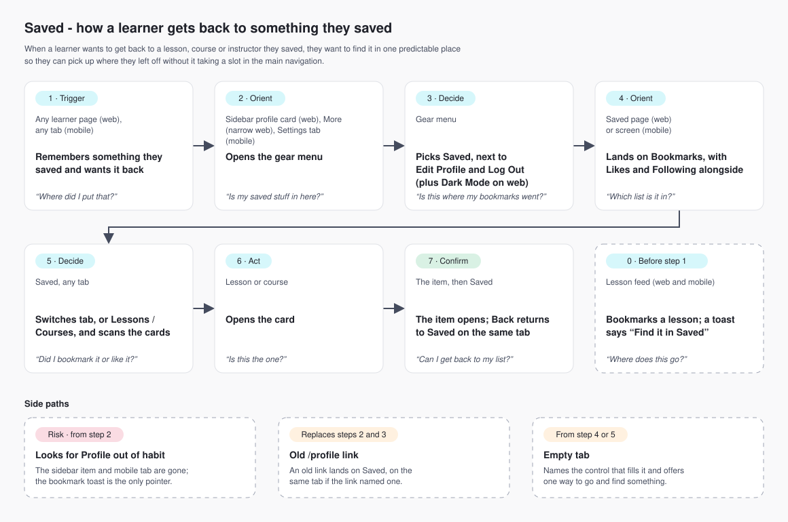

# DES-368: Move saved activity to the gear menu and remove the Profile page

**Ticket:** [DES-368](https://5mins.atlassian.net/browse/DES-368) (In Design Phase, Medium) · **Reporter:** Bruno Carvalho · **PMs:** Divjot Singh, Nicolas Darriulat · **Date:** 2026-11-17
**Source call:** "My Learning page redesign and profile consolidation", 17 Nov 2026 · **Full evidence:** `2026-11-17-DES-368-saved-gear-menu.research.md` (written while the working name was "Your Activity")

---

## 1. Context

### The problem

Profile holds a slot in the main navigation on web and mobile, but all it contains is Bookmarks, Likes and Following, which few learners use. It also competes with My Progress for the role of "my page". Saved activity needs a quieter home so the Profile entry can go.

**Table stakes, not novel.** Keeping saved items one level down, behind an account or settings menu, is the norm in consumer apps (Instagram, Reddit, Noom) and in learning tools (WorkRamp and Skilljar keep saved content inside the learner's profile area, not in main navigation). On mobile, for now, the Profile tab becomes a Settings tab that opens the same menu.

### What the code does today

| Surface | File | Today |
|---|---|---|
| Web sidebar | `src/pages/my-team/MyTeam.tsx`, `learnerSideItems` | Last item is `{ label: 'Profile', icon: UserSquare, path: '/profile' }`. The constant is reused by 8 learner pages (`ForYou`, `Workspace`, `Events`, `ProgramDetails`, `ProgramCourseDetails`, `UserProfile`, `MyProgress`, `Profile`), so one edit covers them all |
| Web gear menu | `src/components/ProfileMenu/ProfileMenu.tsx` | Profile card at the bottom of the sidebar (name, email, 16px `Setting2`). Opens a menu with Edit Profile (goes to `/my-progress/profile`), Dark Mode (toggle row) and Log out (goes to `/onboarding`). Under 1200px the card shrinks to the gear icon alone, with no accessible name and no tooltip; on `/my-progress` the open menu is painted over by the page's cards. No design system doc (navigation.md says so) |
| Narrow web (under 600px) | `src/components/LearnerMobileNav/LearnerMobileNav.tsx` | Sidebar and gear are hidden. A bottom bar (Home, Search, Progress, Feed, More) replaces them; **More** lists Admin, Your Workspace, **Profile** (`/profile`), Knowledge Hub, Dark Mode, Log Out. It has no Edit Profile row. **The menu is clipped off-screen today:** at 390px it runs from 309px to 549px, so labels show as "Adr", "You", "Pro" |
| Profile page | `src/pages/profile/Profile.tsx`, `Profile.css`, `profileItems.ts`; route `/profile` in `src/App.tsx` | Avatar, name and role header, then `Tabs` (Bookmarks, Likes, Following). Bookmarks has a `ContentSwitcher` (Lessons / Courses). Cards: `LessonGridCard`, `WorkspaceCourseCard`, `InstructorCard`. `?tab=<key>` opens a tab but is read once and never written; the switcher is not in the URL. Lists are fixed sample data, the cards do not open anything, and there are no empty states |
| Mobile tab bar | `src/components/mobile/TabNav/TabNav.tsx` | Five tabs: Home, Search, Progress, Feed, Profile |
| Mobile headers | `src/components/mobile/TopNav/TopNav.tsx`, `src/pages/mobile/MobileApp.tsx` | Progress uses the `chips` variant (My Team / My Progress), chips only. Profile uses the `profile` variant: 40px avatar with a gear badge, name, role and an Add button. The gear (`onEditProfile`) and Add (`onAdd`) are not wired |
| Mobile Profile content | `src/pages/mobile/MobileApp.tsx` | **None.** The Profile tab shows its header over an empty screen. Bookmarks, Likes and Following have never been built in the mobile prototype, and there is no mobile gear menu |
| Where items get saved | `src/pages/for-you/components/LessonFeed.tsx` (web), `src/pages/mobile/LessonFeedScreen.tsx`, `src/pages/courses/ProgramCourseDetails.tsx`, `src/pages/mobile/CourseScreen.tsx` | Web lesson feed: a Follow / Following button and a Bookmark row, both on-screen toggles that save nothing and give no feedback. Mobile lesson feed: a Bookmark action, not wired. Course pages: a Save icon, not wired (disabled on mobile). **There is no Like control anywhere in the prototype** |
| Links into `/profile` | whole of `src/` | Only the two navigation entries above. No View All or other deep links |

### Decisions taken

| # | Decision | Reason |
|---|---|---|
| D1 | DES-368 covers only the saved-activity move and the Profile navigation removal | The My Progress to My Learning merge is a separate ticket |
| D2 | One gear-menu item opens one page with three tabs: Bookmarks, Likes, Following | Three menu rows is too much weight for low-usage features; the existing tabbed layout already works |
| D3 | The item and the page are called **Saved** | With Profile gone the menu label is the only signpost, and "Saved" answers the learner's question ("where did my bookmarks go?"). It is the category's word (Instagram, Reddit, LinkedIn Learning). Bookmarks are what people come looking for; Likes and Following ride along |
| D4 | Web: "Profile" is removed from the learner sidebar and from the narrow-web More menu; "Saved" is added to the gear menu | Meets AC2 |
| D5 | Mobile, for now: the Profile tab in the bottom bar becomes a **Settings** tab with a gear icon (still five tabs). Tapping it opens the settings menu as a bottom sheet: Saved, Account Settings, Log Out. Account Settings opens the Settings screen the production app already has (photo, Personal Info, Company Profile, Preferences, Notifications, Privacy, Feedback, Log Out), which is where the profile is edited. Saved opens a screen with the same three tabs as the web page. The mobile menu has no Dark Mode row | The smallest change that removes Profile from mobile navigation and keeps Edit Profile and Log Out reachable. Moving the avatar and gear into the My Progress header is deferred to the My Progress / My Learning work. The mobile app is dark-only, so there is no Dark Mode option there |
| D6 | Edit Profile, Dark Mode and Log Out stay in the web gear menu unchanged; Dark Mode is web only | The ticket asks that existing profile actions remain accessible |
| D7 | The web gear icon (`Setting2` in `ProfileMenu.tsx`) grows from 16px to 20px (`--icon-size-md`) | The gear now leads to content, not only settings, and at 16px it is easy to miss, most of all under 1200px where it stands alone |
| D8 | The menu item uses the Iconsax `Save2` icon, Linear (Library `iconlinear/Saved2`) | Bruno's pick (17 Nov 2026). It reads as "saved"; a pulse-line `Activity` icon would read as learning history |
| D9 | Bookmarking a lesson shows a toast: "Bookmarked. Find it in Saved." | The save moment is the one place the new home can be learnt once Profile leaves the navigation (UX audit, recommendation 1) |

Rejected: three separate gear-menu items; moving the avatar and gear into the mobile My Progress header now (deferred to the My Learning work); a gear in the mobile Home header; "Your Activity" as the name (next to My Progress it reads as learning history); "Saved Content" ("content" is our word, not a learner's); "Bookmarks" (undersells the other two tabs).

What D4 means on narrow web: the gear is hidden under 600px, so "Saved" takes the slot Profile held in the More menu. Otherwise the page would be unreachable at that width.

### The user journey

**Job:** When a learner wants to get back to a lesson, course or instructor they saved, they want to find it in one predictable place so they can pick up where they left off without it taking a slot in the main navigation.

Claude Design: https://claude.ai/artifact/MSTZ5Tdb7ajZajnSK7GvLD

0. **Before** - The learner bookmarks a lesson. A toast says "Bookmarked. Find it in Saved." *Lesson feed (web and mobile).* On their mind: "Where does this go?"
1. **Trigger** - Later, the learner remembers something they saved and wants it back. *Any learner page (web), any tab (mobile).* On their mind: "Where did I put that?"
2. **Orient** - They open the gear menu. *Web: the profile card at the bottom of the sidebar. Narrow web: More in the bottom bar. Mobile: the Settings tab (gear) in the bottom bar, which opens the menu as a bottom sheet.* On their mind: "Is my saved stuff in here?"
3. **Decide** - They pick Saved, next to Edit Profile and Log Out (plus Dark Mode on web; the mobile menu has no Dark Mode row). *Gear menu.* On their mind: "Is this where my bookmarks went?"
4. **Orient** - Saved opens on Bookmarks, with Likes and Following alongside. *Saved page (web) or screen (mobile).* On their mind: "Which list is it in?"
5. **Decide** - They switch tab, or switch Lessons / Courses inside Bookmarks, and scan the cards. *Saved, any tab.* On their mind: "Did I bookmark it or like it? Lesson or course?"
6. **Act** - They open the card. *Lesson or course.* On their mind: "Is this the one?"
7. **Confirm** - The item opens; Back returns to Saved on the same tab and the same Lessons / Courses view. *Lesson or course, then Saved.* On their mind: "Can I get back to my list?"

Side paths:

- **Empty tab (from step 4 or 5).** The tab shows an empty state that names the control that fills it and offers one way to go and find something. Most learners will see this, given the low usage.
- **Old `/profile` link (replaces steps 2 and 3).** A saved link or browser bookmark lands on Saved, on the same tab if the link named one.
- **Looking for Profile out of habit (step 2).** The sidebar item is gone and the mobile tab is now Settings. The bookmark toast (step 0) is the answer for anyone who saves again; see Risks for the rest.

### Acceptance criteria

- **AC1.** Users can find Bookmarks, Likes, and Following from the gear menu.
- **AC2.** Navigation designs no longer show a separate Profile page.
- **AC3.** Updated flows cover web and mobile.

### Out of scope

The My Progress to My Learning merge and its Engagement, Skills and Learning Records tabs; the learner's own profile at `/my-progress/profile` and what Edit Profile opens; adding a Like control, or wiring Bookmark, Save and Follow to real data; the admin People profile; any change to Dark Mode or Log Out behaviour; usage tracking in production; renaming the "Save" icon on course pages to "Bookmark"; aligning "Log out" (gear menu) with "Log Out" (More menu); adding an Edit Profile row to the narrow-web More menu.

---

## 2. Research

Only rows that drove a decision are listed; every source and the dead ends are in the research file. **Sana Labs yielded nothing usable:** its public pages and changelog describe the learner home, not saved items, a profile or a settings menu.

### Saved items behind an account or settings menu

| Source | What it does | Verdict |
|---|---|---|
| [WorkRamp: learner bookmarks](https://help.workramp.com/en/articles/9248118-learner-bookmarks) | Learners find bookmarks at Profile > Saved Content, a tab | Adopt: saved items sit one level down, in a tab (D2) |
| [Skilljar: Saved Content](https://support.skilljar.com/hc/en-us/articles/38190212732813-Saved-Content-Let-Students-Bookmark-Courses-Paths) | Saved courses and paths show on the learner's profile page; admins can switch the feature off | Adopt the placement. Note the admin switch as a later option, not for this ticket |
| [360Learning: bookmark a course or a path](https://support.360learning.com/hc/en-us/articles/16876847026708-Bookmark-a-course-or-a-path) | Bookmarks land in a default "Save for later" playlist | Reject: playlists are a second concept learners would have to learn |
| [LinkedIn Learning, via a university guide](https://careered.libanswers.com/AIUSLR/faq/266407) | Saved courses live in My Library, with a second route under the Me menu | Reject as a main-nav destination; it confirms an account-menu route is familiar |
| [NN/g: hamburger menus and hidden navigation](https://www.nngroup.com/articles/hamburger-menus/) | Hiding navigation roughly halves discoverability and slows tasks | Accept the cost for low-usage features; keep the label literal and the item first in the menu |

### The name

| Source | What it does | Verdict |
|---|---|---|
| [Instagram: Settings and activity](https://mobbin.com/screens/f08baa0d-fca5-4c2c-bbd1-a1e10c367714) | Saved, Archive and Your activity are separate rows in the menu | Reject three rows (D2); adopt "Saved" as the row learners recognise (D3) |
| [Instagram: Your activity](https://mobbin.com/screens/f4598faa-8dfb-4acd-a417-05ddf383d245) | "One place to manage your activity", with Likes inside | Reject as our umbrella: next to My Progress, "activity" reads as learning history |
| [Reddit: Saved](https://mobbin.com/flows/884a30cd-982c-4a03-b05d-4f6ab4483f0e) | One menu row called Saved opens a tabbed screen | Adopt the name and the shape (D2, D3) |

### Empty states for saved lists

| Source | What it does | Verdict |
|---|---|---|
| [The Atlantic: Saved](https://mobbin.com/screens/be11d892-94f3-4e86-a718-ca08c5a27b37) | "Tap the bookmark icon on a story to save it for later", reached from Settings | Adopt: the empty state names the control that fills it |
| [Klarna: Saved](https://mobbin.com/screens/2ea34d6b-324c-49df-b09b-ccc61a3b2403) | Tabs stay visible above the empty state; one button, "Find products" | Adopt: tabs stay, one button per empty state |
| [HYPE: Saved Articles](https://mobbin.com/flows/77e23527-92d8-4b23-b0d3-a2310e4ebac0) | "There is no content to display" | Reject: reads as an error |

### Mobbin

| Screen or flow | What it does | Verdict |
|---|---|---|
| [Reddit: Saved](https://mobbin.com/flows/884a30cd-982c-4a03-b05d-4f6ab4483f0e) | Avatar opens a menu; Saved opens a screen with two tabs | Adopt: the closest match to D2, one item to one tabbed screen. Its account sheet is also a usable reference for blocker 1 |
| [Noom: Saved lessons](https://mobbin.com/flows/aff8f35d-cea6-4534-8e8e-0989d6bea333) | Avatar menu groups Friends, Saved lessons and Settings; the list ends with a line on how to save more | Adopt the grouping of saved items with settings |
| [MasterClass: My Progress](https://mobbin.com/screens/125f0579-2126-4a42-bd27-811f0b255c2c) | Three tabs, no Profile tab; the avatar sits in the My Progress header and bookmarks live there | Adopt: direct precedent for D5 |
| [Spotify: Home](https://mobbin.com/screens/e456a7ac-30f8-4533-adfa-087efc769061) | The avatar shares the header row with the filter chips | Adopt as layout evidence that an avatar and chips fit in one row |
| [Uxcel: bookmarks](https://mobbin.com/screens/ebcee278-eb32-45bc-8cb4-ad8d0927a0e7) | Exercises / Lessons switch inside the bookmarks list | Confirms keeping the Lessons / Courses switcher |
| [Udemy: Account](https://mobbin.com/screens/eb9eeac8-ccb1-40f1-bfd0-3664d76c3905) | Wishlist holds its own tab in the bar | Reject: that is the weight we are removing |

No close match for TikTok's menu, or for an app caught in the act of removing a profile tab; MasterClass and Spotify show the end state only.

### Build For Mars

| Lesson | Principle | Verdict |
|---|---|---|
| [Where did it go?](https://builtformars.com/ux-bites/where-did-it-go) (Stripe) | When a control moves, a reminder appears where it used to be | Not adopted: it adds a moving part for a low-usage feature. The bookmark toast (D9) does the teaching instead. Revisit if usage drops after the move |
| [Reverse Prototype](https://builtformars.com/ux-glossary/reverse-prototype) | Remove something, then check whether anyone misses it | Adopt: this is the test for the whole ticket, and the reason to measure usage after the move |
| [Progressive Disclosure](https://builtformars.com/ux-glossary/progressive-disclosure) | Essential options first, the rest when they become useful | Supports D2 and D4 |
| [A useful empty state](https://builtformars.com/ux-bites/a-useful-empty-state) (Wise) | The empty state teaches the next step | Adopt for all three tabs |

---

## 3. Implementation

### Blockers

1. **Mobile menu rows - settled.** The menu is a bottom sheet (shared `BottomSheet`) holding Listbox list items (listbox.md): 20px icon in `--text-primary`, label, hover fill (Bruno, 17 Nov 2026). Recorded in overlays.md.
2. **Mobile Progress header with an avatar - deferred.** Not needed for this ticket: the entry point is the Settings tab (D5). The header change moves to the My Progress / My Learning work.
3. **The mobile tab bar swaps Profile for Settings.** The Library `Tab nav` set and navigation.md both describe a Profile tab. *Recommendation:* update both in the same task. Needed for AC2 on mobile.
4. **Dark Mode on mobile - settled.** The mobile app is dark-only and has no Dark Mode option, so the mobile menu carries no Dark Mode row (D5). Say so in the Figma callout.
5. **Edit Profile on mobile - settled.** The mobile menu has an Account Settings row in its place, opening the Settings screen where the name and photo are edited (Bruno, 17 Nov 2026). The settings rows have no design system doc yet; they were built from the production app screenshots.
6. **Mobile course card in a list - settled.** Bookmarked courses use the Library mobile course card, widened from 272px to fit the screen (Bruno, 17 Nov 2026). Recorded in cards.md.
7. **Likes can never be filled in the prototype.** There is no Like control on web or mobile, and Follow exists on web only. Not blocking an AC: the ACs are about finding the lists. *Recommendation:* keep the sample data, and note in the Figma callout that Like is a production-only control.

No AC is unbuildable, and no blocker is open.

### Phases

**Phase 0: already in place**

| # | What | Status |
|---|---|---|
| 0.1 | Tabbed page with Bookmarks (Lessons / Courses switcher), Likes, Following and `?tab=` links (`Profile.tsx`) | Done |
| 0.2 | Edit Profile, Dark Mode and Log out in the web gear menu (`ProfileMenu.tsx`, commit `8c5f2c2`) | Done |
| 0.3 | The three empty-state illustrations (`no-bookmarks.svg`, `no-likes.svg`, `not-following.svg` in `src/assets/empty-state-illustrations/`) | Done |

**Phase 1: web prototype**

| # | Change | Components | Verify | AC / step |
|---|---|---|---|---|
| 1.1 | Remove the Profile row from `learnerSideItems` | None new | No Profile item on any of the 8 learner pages, at full width or on the icon rail | AC2 |
| 1.2 | Add **Saved** to the gear menu, opening `/saved`. Recommended first, above Edit Profile. Gear icon grows to 20px (D7). At rail width the gear gets the accessible name "Account menu" and a DS Tooltip, and the open menu sits above page content | `ProfileMenu` row; `Save2` icon, 20px Linear, `--text-primary`; DS `Tooltip` | Menu reads Saved, Edit Profile, Dark Mode, Log out; keyboard reaches it; the menu closes on select. At 1100px, on all 8 learner pages: the gear has a name and tooltip and the whole menu is visible | AC1, steps 2-3 |
| 1.3 | Narrow web: in the More menu, replace Profile with Saved in the same slot, and fix the menu's position so it stays on screen (likely cause: `.profile-menu { left: 0 }` beating `.lmn-more__menu { left: auto }`) | `LearnerMobileNav` row; `Save2`, 24px Bold as the other rows | At 375px every row label is fully visible; More shows no Profile; Saved opens the page | AC1, AC2, step 2 |
| 1.4 | Turn the Profile page into the Saved page at `/saved`. Recommended header: page title "Saved", divider, then the tabs; no avatar, name or role. The page writes the active tab and the Lessons / Courses view to the URL. The tabs' `aria-label` becomes "Saved sections" | Page Header pattern (headers.md), `Tabs`, `ContentSwitcher`, `LessonGridCard`, `WorkspaceCourseCard`, `InstructorCard` | No sidebar item is lit; `?tab=` opens the right tab; switching tab or view updates the URL; light and dark | AC1, steps 4-5 |
| 1.5 | Old links: `/profile` forwards to `/saved` and keeps `?tab=` | Route in `App.tsx` | `/profile?tab=likes` lands on Likes | Side path |
| 1.6 | Empty states, one per list (copy below) | `EmptyState` (plain surface, no border or fill) with the three 72px illustrations; one outlined button | With a list emptied, the tabs and the switcher stay visible; the lesson buttons open For You and the course button opens Your Workspace | Side path |
| 1.7 | Make the cards open their item: course cards open the course page; lesson cards open the For You lesson feed (an assumption, the prototype has no single-lesson route); instructor cards stay inert, as the prototype has no instructor page | Existing `onOpen` / `onClick` props | From each tab and from both Bookmarks views, opening a card and pressing Back returns to the same tab and view | Steps 6-7 |
| 1.8 | Bookmark toast on the web lesson feed: "Bookmarked. Find it in Saved." Shown when a bookmark is added, not when it is removed | DS `Toast` | Bookmarking a lesson shows the toast once; removing the bookmark shows none | Step 0 |

**Phase 2: mobile** (2.1 to 2.3 built in the prototype on 17 Nov 2026)

| # | Change | Components | Verify | AC / step |
|---|---|---|---|---|
| 2.0 | Library first: publish the `Tab nav` variants with Settings in place of Profile | Library (Figma) | Published before 2.1 to 2.3 start | AC2 |
| 2.1 | **Done.** Replace the Profile tab with a Settings tab (gear icon); five tabs stay | `mobile/TabNav`; `Setting2`, 24px Bold as the other tabs | Home, Search, Progress, Feed, Settings at equal widths; no Profile tab | AC2, AC3 |
| 2.2 | **Done.** Tapping Settings opens the menu as a bottom sheet over the current screen: Saved, Account Settings, Log Out. Account Settings opens the Settings screen (`AccountSettingsScreen.tsx`), built after the production app; its rows are display only. The current tab stays selected underneath | `BottomSheet` (blocker 1). No tooltip: the app has no hover | The sheet opens from any tab and closes by tap outside, drag and Escape; the screen underneath does not change | AC1, AC3, steps 2-3 |
| 2.3 | **Done, without empty states** (the lists are fixed sample data). Saved screen, pushed over the current tab with a back button | `mobile/TopNav` `detail` variant titled "Saved"; `Tabs` (as on the mobile course screen); `ContentSwitcher`; `LessonGridCard` in a two-column grid (Library Card/Lessons, View=grid), `mobile/InstructorCard`; widened `mobile/CourseCard`; `EmptyState device="mobile"` | The screen arrives with the standard screen-swap animation and respects reduced motion; cards open their item and Back returns to the same tab; Back from Saved returns to the root of the tab the learner was on | AC1, AC3, steps 4-7 |
| 2.4 | Bookmark toast on the mobile lesson feed, in Figma only (the mobile Bookmark action is not wired) | DS `Toast` | Shown on the mobile lesson feed screen in Figma | Step 0 |

**Phase 3: Figma and docs**

| # | Change | Verify | AC |
|---|---|---|---|
| 3.1 | Web screens: sidebar without Profile; gear menu open with the cursor on Saved (hover state shown); Saved on each tab; one empty state; the bookmark toast; narrow-web More menu | Built from Library components, light and dark | AC1, AC2, AC3 |
| 3.2 | Mobile screens: tab bar with Settings; menu sheet; Saved on each tab; one empty state; the bookmark toast | Dark only | AC1, AC2, AC3 |
| 3.3 | Library: retire the old Profile tab and header variants, only once My Learning confirms they are not needed | No screen still uses them | AC2 |
| 3.4 | Docs: navigation.md (menu items, the Settings tab); a short `ProfileMenu` entry, which has no doc today | Docs match the code | - |

**Copy** (learner register, per the 5Mins copy skill; no exclamation marks. "Bookmark" is the action; "Saved" is the place)

| Where | Copy |
|---|---|
| Menu item and page title | Saved |
| Tabs | Bookmarks · Likes · Following (unchanged) |
| Bookmarks, Lessons, empty | **No bookmarked lessons yet** / Use the bookmark on any lesson to keep it here for later. / Explore Lessons |
| Bookmarks, Courses, empty | **No bookmarked courses yet** / Use the bookmark on any course to keep it here for later. / Browse Courses |
| Likes, empty | **No likes yet** / Lessons you like will be here, so they're easy to find again. / Explore Lessons |
| Following, empty | **Not following anyone yet** / Follow an instructor from one of their lessons and they'll be listed here. / Explore Lessons |
| Toast, on bookmark | Bookmarked. Find it in Saved. |
| Gear, accessible name and tooltip | Account menu |

Copy note: the copy skill asks for sentence-case menu items and buttons; the house rule (Title Case buttons) and the existing menu (Edit Profile, Dark Mode) win.

### Risks to watch during build

- **Habit.** Learners who used Profile will look for it. The bookmark toast teaches the new home only to people who save again. If post-move usage drops, the cheapest next fix is a one-time pointer on the gear (Build For Mars, "Where did it go?").
- **Two things called profile.** Edit Profile still opens `/my-progress/profile`, which looks like a profile page. AC2 is about navigation entries, so this is expected until My Learning lands; say so in the Figma callout.
- **Shared constant.** `learnerSideItems` feeds 8 pages; check each one, including the icon rail.
- **A tab that opens a sheet.** The other four mobile tabs switch screens; Settings opens a sheet over the current one. Keep the current tab lit while the sheet is open so the learner does not lose their place.
- **Second level inside tabs.** The Lessons / Courses `ContentSwitcher` is an existing, sanctioned exception to the "chips only" rule (drift-report.md). Keep it; do not add a second tab bar.
- **The Add button** on the mobile Profile header disappears with the tab. It is not wired, but confirm nothing in production depends on it.

### UX audit

**Verdict: ready after plan fixes** (pre-build audit, 17 Nov 2026, run against the draft that still used the working name "Your Activity"). Full audit: `2026-11-17-DES-368-saved-gear-menu.ux-audit.md`; current-state screenshots in `2026-11-17-DES-368-ux-audit-screens/`.

| Screen or flow | Score (1-10) |
|---|---|
| Web gear menu, full width | 7 |
| Web gear at rail width (600-1199px) | 4 |
| Narrow web More menu (under 600px) | 3 |
| Saved page | 7 |
| Open an item and return | 4 |
| Empty states | 6 |
| Mobile route: Progress, avatar, menu | 4 |
| Mobile Saved screen | 5 |
| Looking for Profile out of habit | 3 |
| Plan as a whole | 6 |

Changes made to the plan as a result:

- Bookmark toast and a "Before" step in the journey (D9, 1.8, 2.4).
- More menu position fix and a label-visibility check at 375px (1.3).
- Rail-width gear: accessible name, tooltip and menu layering moved from Risks into 1.2.
- Tab and Lessons / Courses view written to the URL; each card's destination named; step 7 reworded to "the item opens" (1.4, 1.7, 2.3).
- Icon changed from `Activity`; it is now `Save2` (D8). The name changed to "Saved" (D3), which answers the audit's concern that "Your Activity" reads as learning history.
- Mobile: the audit scored the earlier route (Progress tab, then avatar) 4 out of 10 for three taps through an unrelated tab. That route is replaced by a Settings tab that opens the menu in one tap (D5); the Library change moved ahead of the mobile build (2.0).
- Empty-state copy names the bookmark control; bookmarked courses get "Browse Courses".
- Consistency gaps ("Save" vs "Bookmark", "Log out" vs "Log Out", no Edit Profile row on narrow web) recorded as out of scope; the leftover "Profile sections" label is fixed in 1.4.
- Mobile prototype scope and impersonation behaviour added to Still open.

### Still open

Whether Saved keeps the avatar and name header (lean: drop it for a plain page title); where Saved sits in the menu (lean: first, above Edit Profile); what old `/profile` links do (lean: forward to the new page, keeping the tab); whether lesson cards should open the For You feed or something else; how "low usage" is measured and whether we track it after the move; whether an admin impersonating a learner should see that learner's Saved lists (Profile shows them today); whether to check the name "Saved" with a few learners before Figma is final.
