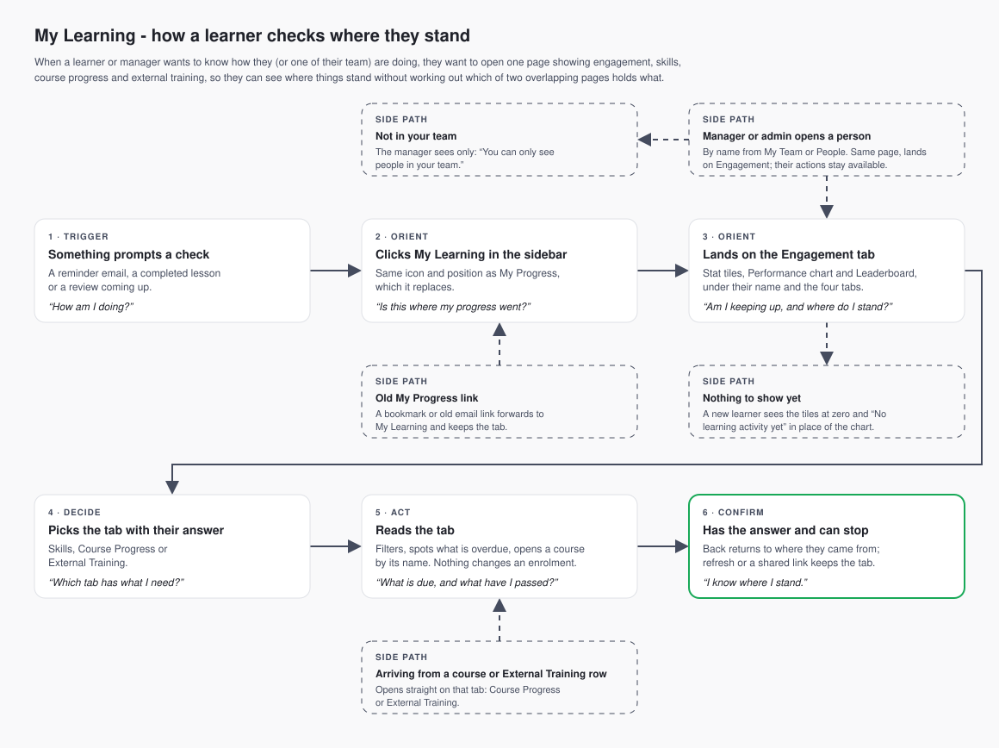

# DES-369: One My Learning page in place of My Progress and Profile

**Ticket:** [DES-369](https://5mins.atlassian.net/browse/DES-369) (In Design Phase, Medium) · **Reporter:** Bruno Carvalho · **Related:** [DES-336](https://5mins.atlassian.net/browse/DES-336), DES-368 · **Date:** 2026-11-17
**Source call:** "My Learning page redesign and profile consolidation", 17 Nov 2026 · **Full evidence:** `2026-11-17-DES-369-my-learning-page.research.md`

---

## 1. Context

### The problem

A learner's learning is split across two pages: My Progress (a dashboard of cards) and the profile page behind it. Managers see a third version of the same person in My Team. Skills appear in two of them, and nobody can say which page holds what. One page, My Learning, becomes the single user-profile page for learner, manager and admin.

**Table stakes, not novel.** One profile that the person, their manager and an admin all open is the norm in learning and HR tools (Cornerstone's Universal Profile, the Workday worker profile), and "My Learning" is the category's name for the learner's own page (Coursera, Unity Learn).

### What the code does today

| Surface | File | Today |
|---|---|---|
| The foundation | `src/pages/user-profile/UserProfile.tsx` | Routed at `/people/:id` (admin), `/my-team/people/:id` (manager) and `/my-progress/profile` (learner). `TABS = ['Engagement', 'Skills', 'Course Progress', 'External Training']`; **Engagement and Skills are disabled and empty**. Opens on Course Progress, or on External Training with `?tab=external-training` (read once, never written back) |
| Telling viewers apart | Same file: `isLearnerView`, `fromMyProgress`, `externalViewer` | By route only. `externalViewer` is `admin`, `manager`, `learner` or none ("You can only see people in your team."), and today it only drives the External Training tab |
| Learner's own page | Same file | **Not view only.** Checkboxes, the bulk bar and every row action (`ROW_MENU_ITEMS`: Send reminder, Extend due date, Unenrol and five more) show for the learner. A filled Edit Profile button sits in the header and does nothing |
| External Training tab | `user-profile/components/ExternalTrainingTab/` | Complete (DES-336). Admins add, edit and delete; manager and learner read only |
| My Progress dashboard | `src/pages/my-progress/MyProgress.tsx`, `myProgressData.ts` | Stat tiles (`progressStats`: Points, Jewels, Streak, Certificates), then cards: 5Mins Courses, Skill Development, External Training, Leaderboard. A prototype switcher (`VERSIONS`, `?hide=`) shows that a tenant can turn off Leaderboard, Skill Development and External Training |
| Performance chart | `EngagementChart` in `src/pages/my-team/EngagementTab.tsx` | **Exists once, at team level, hand-built.** Same legend and Cumulative checkbox as the screenshot, titled "Engagement". The checkbox does not change the chart. **No design system doc, no chart component, no chart colours in the tokens** (one colour is a raw value with a lint exception). `src/pages/chart-lab` holds quiz answer charts only |
| Leaderboard | `MyProgress.tsx` (`leaderboards`, `getRankMedal`) and a second copy in `EngagementTab.tsx` | Two builds. The My Progress one uses the documented Library medals (gamification.md) |
| Skills | `skillProgress` rows on My Progress; `SkillsCompetency` in `EngagementTab.tsx`; `SkillCard` | **No learner skills page exists in the prototype.** "View All Skills" is disabled. The page "built by Johan" is in production only |
| Navigation | `learnerSideItems` in `MyTeam.tsx`; `LearnerMobileNav.tsx`; chips in `MyTeam.tsx` and `MyProgress.tsx` | Sidebar item "My Progress" to `/my-progress`. Under 600px: a Progress tab with chips My Team / My Progress |
| `/profile` | `ProfileRedirect` in `src/App.tsx` | Already forwards to Saved (DES-368). The Profile page is gone |
| Links that open External Training | `ExternalTrainingRecords.tsx` (admin), `LearningRecordsTab.tsx` (manager), My Progress View All | All use `?tab=external-training` |
| Native app | `src/pages/mobile/MyProgressScreen.tsx`, `ExternalTrainingScreen.tsx` | My Progress reuses the web cards in one column, tables included. External Training is already a card list with a bottom sheet. No profile, Course Progress or Skills screen |

Where each piece of My Progress goes:

| My Progress today | Destination |
|---|---|
| Stat tiles (Points, Jewels, Streak, Certificates) | Engagement, first |
| (not on My Progress) Performance chart | Engagement, second |
| Leaderboard card | Engagement, third |
| Skill Development card | Skills tab |
| 5Mins Courses card (latest four, Passed / Not Passed) | Dropped; Course Progress already lists every course with score and status |
| External Training card (latest three) | Dropped; the External Training tab lists them all |
| Tenant on/off versions | See blocker 4 |

### Decisions taken

| # | Decision | Reason |
|---|---|---|
| D1 | My Progress and Profile are replaced by one page, My Learning | Meeting decision, 17 Nov |
| D2 | My Learning is the existing My Team user-profile page | Already built; no new foundation |
| D3 | Four flat tabs: Engagement, Skills, Course Progress, External Training | Bruno's call; nothing nested |
| D4 | Engagement is the landing tab, for learner, manager and admin alike | Bruno's call |
| D5 | Exception: arriving from an External Training row (for example the admin records list) opens the External Training tab | Bruno's call; matches the existing `?tab=external-training` behaviour |
| D6 | Engagement holds gamification stats, then the Performance chart, then the Leaderboard | Bruno's call; no Skill Development section on Engagement |
| D7 | Skills is its own tab, built from the production Skills tab ([screenshot](./2026-11-17-DES-369-skills-tab-reference.png)): read only, with no actions. This ticket builds the learner's view; any manager actions on skills are out of scope | Skills live in one place only; Bruno, 17 Nov |
| D8 | No separate "5Mins Courses" view from Learning Records | Course Progress covers it |
| D9 | The learner's own page is view only: no send reminder, extend due date or unenrol | Bruno's call |
| D10 | The My Progress nav item is renamed My Learning, and `/profile` goes away | Bruno's call |
| D11 | Web app first; native app is a later phase | Bruno's call |
| D12 | Bookmarks, Likes and Following move to the gear menu | Covered by DES-368 |
| D13 | Rows and links about courses (My Team Course Tracker rows, People rows, reminder email links) open the Course Progress tab; the sidebar item and a person's name still open Engagement | UX audit, taken by Bruno; the same rule as D5, and it keeps managers one click from their job |
| D14 | On the learner's own page the course name opens the course | UX audit, taken by Bruno; an Overdue badge is no longer a dead end, and no enrolment changes (D9 holds) |
| D15 | The Leaderboard shows only on the person's own page; managers and admins viewing someone else do not see it until a "this person's row" state is designed | UX audit, taken by Bruno; unmarked, it is the same team list on every profile |
| D16 | The mobile design is split into a follow-up ticket | UX audit, taken by Bruno; web first (D11) means this ticket cannot meet that half of AC1 |

Rejected: External Training nested inside a Learning Records tab (tabs inside tabs); a Skill Development section on Engagement (duplicates the Skills tab); keeping the My Progress dashboard alongside (keeps the two-page confusion).

### The user journey

**Job:** When I want to know how I (or one of my team) am doing, a learner or manager wants to open one page showing engagement, skills, course progress and external training, so they can see where things stand without working out which of two overlapping pages holds what.

Claude Design: https://claude.ai/artifact/8j28J35mUjkQ89LjBcfubx

Main journey: a learner on web.

1. **Trigger** - Something prompts the question: a reminder email, a completed lesson, a review coming up. *Any learner page.* On their mind: "How am I doing?"
2. **Orient** - They click My Learning in the sidebar, where My Progress used to be, same icon, same position. *Learner sidebar.* On their mind: "Is this where my progress went?"
3. **Orient** - The page opens on Engagement: their name, four tabs, then stat tiles, the Performance chart and the Leaderboard. *My Learning, Engagement tab.* On their mind: "Am I keeping up, and where do I stand?"
4. **Decide** - They pick the tab that holds their question: Skills, Course Progress or External Training. *Tab bar.* On their mind: "Which tab has what I need?"
5. **Act** - They read it. On Course Progress they filter or sort, spot what is overdue, open a course by its name (D14) and download a certificate. Nothing on the page changes an enrolment. *Any tab.* On their mind: "What is due, and what have I passed?"
6. **Confirm** - They have their answer. Back returns to where they came from, and the tab is in the address bar, so refresh or a shared link returns to the same view. *Same tab.* On their mind: "Do I know where I stand, and can I get back here?"

Side paths:

- **Manager opens a team member (replaces steps 1 and 2).** My Team, click a person's name. The same page opens on Engagement with My Team lit; a Course Tracker row opens it on Course Progress instead (D13). Row actions stay available to the manager.
- **Arriving from a course or External Training row (replaces steps 2 to 4).** Course rows open Course Progress (D13). From the admin records list, or the manager's Learning Records tab, the person's name opens the page on External Training (D5). Admins can add, edit and delete there; managers read only.
- **Admin opens a person from People (replaces steps 1 and 2).** Same page in the admin shell, with the People breadcrumb and Assign Courses, landing on Engagement.
- **Old link (replaces step 2).** `/my-progress` and `/my-progress/profile` forward to My Learning and keep the tab.
- **Not in your team.** A manager who opens someone outside their team sees only "You can only see people in your team."; nothing else on the page renders (phase 1.12).
- **Nothing to show yet (step 3).** A new learner sees the tiles at zero and an empty state in place of the chart.

### Acceptance criteria

- **AC1.** A first-pass web and mobile design shows one My Learning page in place of the separate My Progress and Profile pages.
- **AC2.** The design identifies where Engagement, Skills, course progress, and External Training live.
- **AC3.** The design reuses existing patterns where possible and flags any unresolved duplication or mobile-layout issues for review.

Note on AC1: the mobile half is deferred by D11. This document delivers the web design and records the mobile constraints (phase 3); it does not deliver a mobile design. The mobile design becomes a follow-up ticket (D16).

### Out of scope

The native app design; Bookmarks, Likes and Following and the gear menu (DES-368); what Edit Profile opens; changes to My Team's own tabs (Course Tracker, Engagement, Learning Records); the External Training tab's behaviour (DES-336); what managers and admins can do in row actions; manager actions on the Skills tab; real gamification data; the admin Learning records pages; tenant settings for switching panels on or off.

---

## 2. Research

Only rows that shaped the plan are listed; every source and the dead ends are in the research file. **Sana Labs yielded nothing usable:** its [changelog](https://sanalabs.com/sana-learn-changelog.html) covers admin reporting dashboards, not a learner profile, a manager's view of a person, skills or gamification.

### One profile for the person, their manager and an admin

| Source | What it does | Verdict |
|---|---|---|
| [Cornerstone: Universal Profile, View Team](https://help.csod.com/help/csod_0/Content/User/Universal_Profile/Universal_Profile_-_My_Team_Drop-down.htm) | One profile for everyone. A manager picks a report and lands on the same page of that person's profile; without access they are redirected with a message | Adopt: confirms D2. The message on no access matches our team guard |
| [Workday: View My Team's Learning](https://hr.emerson.edu/hc/en-us/articles/49252845385747-View-My-Team-s-Learning) (customer guide) | A team report for the manager; each person's learning sits on their own profile under a Learning tab | Adopt: My Team is the overview, My Learning is the individual |
| [TalentLMS: view a user's gamification statistics](https://help.talentlms.com/hc/en-us/articles/26652216307100-How-to-view-a-user-s-gamification-statistics-in-TalentLMS) | An admin can open one user's points, badges and level | Precedent for blocker 3; does not settle it |
| [Docebo: Gamification](https://help.docebo.com/hc/en-us/articles/360020081200-Gamification-and-the-Reward-Shop) | Learners reach "My gamification" from the profile menu; admins can anonymise leaderboard names | Reject the placement (hidden behind a menu). Note the anonymise option for blocker 3 |

### Tabs and the landing tab

| Source | What it does | Verdict |
|---|---|---|
| [NN/g: Tabs, used right](https://www.nngroup.com/articles/tabs-used-right/) | High-use content first and selected by default; no stacked tab rows; "the fewer tabs, the better" | Adopt: supports D3. It also says the default should be the most-used tab, which for managers may be Course Progress (see Risks) |
| [Workable: employee profile](https://mobbin.com/screens/dc543f3e-fe10-4abf-a3cd-5f002d81b001) | Two rows of tabs on one profile | Reject: the nesting we ruled out |
| [Remote: employee profile](https://mobbin.com/screens/55627e95-ef55-472e-9580-fb1e2615d345) | One flat row of tabs on a person's profile | Adopt: flat tabs scale |

### Mobbin

| Screen | What it does | Verdict |
|---|---|---|
| [Unity Learn: My Learning](https://mobbin.com/screens/90e21642-8418-4035-a9d7-336a1fff4eb3) | "My Learning" in the main nav, one flat tab row, landing on Activity (points, levels, badges). [My Profile](https://mobbin.com/screens/ddbc48ee-e072-4b7e-bdf8-d0af7141c54b) is one of its tabs | Adopt: the closest match to D1, D3 and D4. Reject its Saved and Settings tabs (DES-368 moved those) |
| [Coursera: My Learning](https://mobbin.com/screens/ff884482-7343-4d72-b38d-74436b6dc450) | "My Learning" as the nav label, landing on courses in progress | Adopt the name. Reject the course-first landing (D4) |
| [Duolingo: Profile](https://mobbin.com/screens/79f40392-fe31-44d0-97b6-65858708cfec) | Name, then four stat tiles, then achievements | Adopt: tiles first on Engagement (D6) |
| [Circle: Leaderboard](https://mobbin.com/screens/cd5daccd-6265-486c-be44-b4c182c6c4f0) | The viewer's own standing above the list; a period filter; "How do points work?" | We already have the period filter and the points tooltip. Own standing is an open question: we have no such state |
| [Mindvalley (iOS): Progress](https://mobbin.com/screens/15b37d80-6b50-4618-82c6-06db8da02423) | Streak, stat tiles and progress bars, no table | Keep for the native phase |

No close match for the same profile shown to its owner and to their manager, or for a monthly activity chart on a learner profile.

### Build For Mars

| Lesson | Principle | Verdict |
|---|---|---|
| [Gamification](https://builtformars.com/ux-glossary/gamification) | Points and leaderboards "bolted on" rarely change behaviour; "visualise progress richly" | Supports the chart sitting between the tiles and the Leaderboard. A caution for D4: Engagement must show progress, not only scores |
| [Dynamic leaderboard motivation](https://builtformars.com/ux-bites/dynamic-leaderboard-motivation) | The leaderboard frames the viewer's own position | Not adopted now: our Leaderboard has no "your row" state. Open question |
| [Changing the default tab](https://builtformars.com/ux-bites/changing-the-default-tab) | The default tab depends on who is looking and where from | Supports D5 |
| [Default Bias](https://builtformars.com/ux-glossary/default-bias) | Most people stay with the default | Risk for managers who come to chase courses |
| [Where did it go?](https://builtformars.com/ux-bites/where-did-it-go) | A reminder where a moved control used to be | Not adopted: the item keeps its icon and position and old links forward |

No close match for merging two overlapping pages or renaming a navigation item.

---

## 3. Implementation

### Blockers

1. **Skills tab source - settled by Bruno, 17 Nov.** The production Skills tab is the reference: [screenshot](./2026-11-17-DES-369-skills-tab-reference.png). A card-row table with two columns, Skill name (skill icon, name, info icon) and Skill level (progress bar and "0/5", sortable, with an info icon), paged 10 at a time ("1-10 of 12"). It is read only with no actions: this ticket builds the learner's view, and any manager actions on skills are out of scope. The screenshot shows a fourth tab called Certificates; that is production today, and this design keeps External Training (D3).
2. **Performance chart - settled by Bruno, 17 Nov: reuse the team chart.** One hand-built copy exists at team level (`EngagementChart`), with no chart component, no chart colours in the tokens, and a Cumulative checkbox that does nothing. It is reused as it is, moved to where both pages can use it, with the screenshot's title and labels. A chart doc is written in phase 2 once its Figma source is found. Do not restyle it or add a chart library in this ticket.
3. **What a manager or admin sees on Engagement - settled by Bruno, 17 Nov.** They see that person's stat tiles and Performance chart, read only. The Leaderboard is off for them (D15).
4. **Tenants can switch panels off - settled by Bruno, 17 Nov.** My Progress shows versions without Leaderboard, Skill Development or External Training. A switched-off panel hides its tab (Skills, External Training) or its section (Leaderboard); tabs are never shown disabled. Show one such version in Figma.
5. **Stat tiles - settled by Bruno, 17 Nov.** "Duels" in the meeting notes was a typo for Jewels. The four existing tiles (Points, Jewels, Streak, Certificates) move as they are; there is no duels feature.
6. **The mobile half of AC1 - settled by Bruno, 17 Nov.** It is split into a follow-up ticket (D16).

### Phases

**Phase 0: already in place**

| # | What | Status |
|---|---|---|
| 0.1 | Profile page with the four tab names, the person header, and the three routes (`UserProfile.tsx`) | Done |
| 0.2 | Course Progress tab: view switcher, status tiles, filters, table, certificates | Done |
| 0.3 | External Training tab with admin, manager and learner modes, and `?tab=external-training` links from both records lists (DES-336) | Done |
| 0.4 | Stat tiles, Leaderboard and skill rows (on My Progress); the chart (on My Team) | Done, in the wrong place |
| 0.5 | `/profile` forwards to Saved; Bookmarks, Likes and Following in the gear menu (DES-368) | Done |

**Phase 1: web prototype**

| # | Change | Components | Verify | AC / step |
|---|---|---|---|---|
| 1.1 | Rename the sidebar item to **My Learning**, opening `/my-learning` (the learner's own page). Same icon (`Medal`), same position. Rename the narrow-web chip to match. Add the `/my-learning` route and update the two checks that pick the learner shell and light the sidebar (they test for `/my-progress` today). On narrow web the page gets the My Team / My Learning chip row and lights the Progress tab. Do this together with 1.8 | `learnerSideItems`; `LearnerMobileNav`; `Chip` | Every learner page shows My Learning, lit on the page, at desktop and 375px; no "My Progress" label remains on web | AC1, step 2 |
| 1.2 | Land on Engagement for all three viewers. Every tab gets a key in the address bar (`engagement`, `skills`, `course-progress`, `external-training`) and writes it on change by replacing the history entry, so Back leaves the page. An unknown or switched-off key falls back to Engagement. Course doors (Course Tracker rows, People rows, reminder email links) link to `?tab=course-progress` (D13) | `Tabs` | `/my-learning`, `/my-team/people/:id` and `/people/:id` open on Engagement; `?tab=external-training` and `?tab=course-progress` open their tabs; a Course Tracker row opens Course Progress; after switching tabs, one Back returns to the previous page; refresh keeps the tab; `?tab=nonsense` opens Engagement | AC2, steps 3, 4, 6; D4, D5, D13 |
| 1.3 | Engagement, first: the four stat tiles with their tooltips, moved from My Progress. Not clickable (no destination exists), so the tile arrows are removed. Fix the sample Points value ("62%" today, against 1,078 pts on the Leaderboard) | `StatTile`, progress illustrations (gamification.md) | Four tiles in one row; tooltips open on hover and focus; light and dark | AC2, step 3 |
| 1.4 | Engagement, second: the Performance chart (blocker 2) | Existing `EngagementChart`, `Checkbox`, `Tooltip` | Title "Performance"; legend and Cumulative as in the screenshot; six months. Cumulative either works or takes the `.ui-disabled` treatment; the inert "Last 6 months" button is not carried over | AC2, step 3 |
| 1.5 | Engagement, third: the Leaderboard from My Progress (Team / Company, This week / This month). The My Team copy is left alone. Shown only on the person's own page (D15) | `ContentSwitcher`, `Dropdown`, `Avatar`, rank medals | Team is the default; the list scrolls inside its card and takes keyboard focus; a manager or admin viewing someone else sees no Leaderboard | AC2, step 3 |
| 1.6 | Skills tab, built from the production screenshot (blocker 1): Skill name and Skill level columns, sortable level, 10 per page | `Table`, Skill-icons illustrations, progress bar, info Tooltip | The tab is enabled and matches the screenshot; rows are not buttons and nothing on them looks pressable; nobody has actions on it; nothing about skills appears on Engagement | AC2, AC3, step 4 |
| 1.7 | The learner's own page is view only: no checkboxes, no bulk bar, no row actions menu. The per-row certificate Download stays, and the course name opens the course (D14). View only is decided by who is looking, not by the route: a person opening their own page through My Team gets it too. The header's Edit Profile button takes `.ui-disabled` on the person's own page and is hidden for managers and admins. Managers and admins keep today's actions on other people | `Table` without `selectable`; `externalViewer` already says who is looking | On `/my-learning`, and on `/my-team/people/1` (the signed-in learner), no control changes an enrolment and a course name opens its course; on other `/my-team/people/:id` and `/people/:id` pages nothing changes | AC1, step 5; D9 |
| 1.8 | Retire the dashboard: `/my-progress` and `/my-progress/profile` forward to `/my-learning` and keep `?tab=`. Keep `MyProgressContent` in the code, because the native prototype still uses it | Routes in `App.tsx` | `/my-progress/profile?tab=external-training` lands on External Training; `/mobile` still works | AC1, side path |
| 1.9 | Switched-off panels (blocker 4): keep the prototype's version control on the new page | `Tabs` | With Skills off there are three tabs and no gap; with Leaderboard off Engagement ends after the chart | AC3 |
| 1.10 | Empty Engagement for a learner with no activity (copy below) | `EmptyState`, plain surface | Tiles read 0; the chart area shows the empty state; tabs stay | Side path |
| 1.11 | Narrow web (under 600px): check the page holds. The tab row and the table scroll sideways as they do today, and the active tab scrolls into view on arrival; no card layout is designed here | Existing behaviour | At 375px: no page-level sideways scroll; all four tabs reachable; arriving on External Training shows that tab without scrolling | AC3 |
| 1.12 | Guard the whole page for a manager opening someone outside their team. Today only the External Training tab is guarded; the header and Course Progress, with its row actions, still render | Existing team guard message | A manager opening a non-report sees only "You can only see people in your team.": no header details, tabs, tiles or actions | Side path |

**Phase 2: Figma and docs**

| # | Change | Verify | AC |
|---|---|---|---|
| 2.1 | Web screens: My Learning on each of the four tabs for the learner; the manager's and admin's view of a person; arrival on External Training from a records row; one switched-off version; the empty Engagement | Library components, light and dark; flow callouts name the open questions | AC1, AC2, AC3 |
| 2.2 | A callout listing the duplication and mobile issues left for review (see Still open), and two design system gaps: the chart has no doc, and the Leaderboard has no "this person's row" state | Present on the flow | AC3 |
| 2.3 | Docs: navigation.md (My Learning replaces My Progress; Profile removed from the item list); a chart doc once its Figma source is confirmed; a Leaderboard entry in gamification.md | Docs match the code | - |
| 2.4 | Remove the My Progress web screens from Figma, or mark them as replaced | No web screen still shows My Progress | AC1 |

**Phase 3: native app (later, not specified here)**

Constraints recorded from the 17 Nov meeting, for whoever picks this up:

- Tables are not viable on mobile. This drives everything else.
- External Training is already solved: a card list, with the detail in a bottom sheet (`ExternalTrainingScreen.tsx`).
- Course Progress needs the same treatment and has no design yet.
- Engagement is likely skipped on mobile; the focus is Skills, 5Mins Courses and External Training.
- Today the app's Progress tab shows the My Progress cards, tables included, and has no profile screen. The header change deferred from DES-368 (avatar and gear on this screen) belongs here too.

**Copy** (learner register, per the 5Mins copy skill; no exclamation marks)

| Where | Copy |
|---|---|
| Sidebar item and narrow-web chip | My Learning |
| Tabs | Engagement · Skills · Course Progress · External Training (unchanged) |
| Chart title | Performance |
| Chart legend | Total learning moments · Lessons watched · Quizzes & Polls · Cumulative |
| Tooltip on "Total learning moments" (proposed, to confirm) | Lessons watched plus quizzes and polls answered. |
| Leaderboard | Leaderboard · Team / Company · This week / This month (unchanged) |
| Empty Engagement, own page | **No learning activity yet** / Complete a lesson and your activity will show here. |
| Empty Engagement, someone else's page | **No learning activity yet** / Activity will show here once {first name} completes a lesson. |
| Outside your team | You can only see people in your team. (unchanged) |

Copy notes: the team chart says "Lessons completed" where the screenshot says "Lessons watched"; use one on both. Tab labels keep their existing Title Case, as the copy skill allows for feature names.

### Risks to watch during build

- **Managers and admins chasing courses.** Settled by D13: rows and links about courses open Course Progress. Check every course door during build (Course Tracker rows, People rows, reminder email links); a missed one lands on Engagement.
- **The learner can act on their own enrolments today.** 1.7 removes that. Decide it by who is looking, not by the route, and check all three routes after the change.
- **Shared code.** `learnerSideItems` feeds every learner page, and the native prototype imports `MyProgressContent`. Deleting the My Progress files breaks `/mobile`.
- **"My Learning" over someone else's name.** For a manager the page is a team member's profile under My Team; the label My Learning only ever points to your own page. Keep My Team lit there, as today.
- **Two Leaderboards and two skills views remain at team level** (My Team's Engagement tab). That is deliberate: team view and person view. Say so in the Figma callout so it is not read as leftover duplication.
- **The chart is unverified design.** It was built by hand without a doc. Do not treat its colours or spacing as approved until blocker 2 is closed.
- **Edit Profile appears twice** (page header and gear menu) and neither goes anywhere.

### UX audit

**Verdict: ready after plan fixes; overall 6/10.** Run before build by a reviewer who saw only this document and the journey. Full audit: [ux-audit](./2026-11-17-DES-369-my-learning-page.ux-audit.md). It was made from the code and earlier screenshots; the dev server was not running, so no new screens were captured.

| Screen or flow | Score |
|---|---|
| My Learning in the sidebar | 8 |
| Engagement as landing tab (learner) | 5 |
| Four flat tabs | 7 |
| Course Progress, learner view only | 6 |
| Confirm | 5 |
| Manager or admin opens a person | 4 |
| Arrival from an External Training row | 8 |
| Old My Progress links | 8 |
| Not in your team | 3 |
| Empty Engagement | 7 |
| Narrow web | 4 |

Changes made to the plan as a result (Bruno took 12 of 14 recommendations):

- Course doors open Course Progress (D13; phase 1.2).
- The course name opens the course on the learner's own page (D14; phase 1.7).
- The Leaderboard is off for managers and admins viewing someone else (D15; phase 1.5), and its missing own-row state is listed as a design system gap (2.2).
- The mobile design is split into a follow-up ticket (D16).
- Tab changes replace history, and an unknown or switched-off tab falls back to Engagement (1.2).
- View only is decided by who is looking, and the new route is named in the plan (1.1, 1.7).
- The whole page is guarded for someone outside the team (new phase 1.12).
- Dead controls are removed or disabled: Edit Profile, Cumulative, tile arrows, skill rows, "Last 6 months" (1.3, 1.4, 1.6, 1.7).
- The sample Points value is fixed (1.3).
- Narrow web lights the right nav tab and scrolls the active tab into view (1.1, 1.11).
- Blocker 3 was closed before phase 1: managers and admins see the tiles and chart, read only.
- The journey diagram gains the "Not in your team" and "Nothing to show yet" side paths.

Not taken, left open: one legend label on both charts; retitling the chart "Learning activity".

### Still open

Native app: how Course Progress works without tables, and whether Engagement appears at all; where the Performance chart's Figma source is, so its doc can be written (the code has one hand-built copy and no doc); how the Leaderboard marks a person's own row (no such state exists; needs a Figma design); what the "Total learning moments" tooltip says; whether "Passed / Not Passed" from the old 5Mins Courses card is needed now that Course Progress shows Completed / Failed; whether narrow web needs more than sideways scrolling before the native design lands; whether the chart legend says "Lessons watched" (screenshot) or "Lessons completed" (My Team's chart), given that one label on both means changing My Team's chart, which is out of scope here; whether the chart keeps the title "Performance" or becomes "Learning activity".
