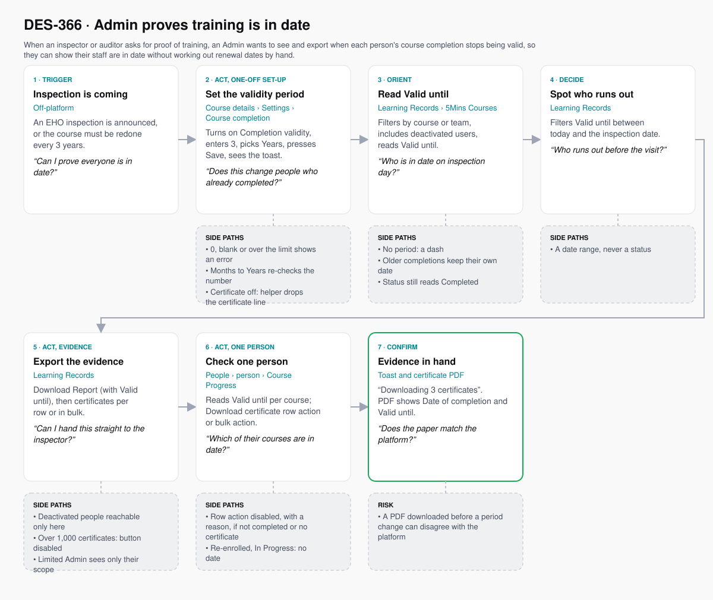

# DES-366: Course validity period and Valid until dates on completions

Status: In Design Phase · Owner: Bruno Carvalho · Reporter: Divjot Singh · Engineering: DEV-5167, DEV-5171, DEV-5170 · Supporting research: `2026-11-20-DES-366-course-validity-period.research.md`

---

## 1. Context

### The problem

Compliance Admins have to show, for example at an EHO inspection, that each person's training is still in date. Today a completion never expires and nothing on the platform shows when training is due again, so Admins work renewal dates out by hand. One date per completion, set by the course, solves this without new statuses or automation. This is table stakes for a compliance LMS: Workday, TalentLMS, Docebo, Mitti (SafetyCulture) and Moodle Workplace all set a validity period on the course or certification and show an expiry date on each record. What is less common is our "date only, no Expired status" stance, which suits customers whose courses renew automatically.

### What the code does today

| Area | File / component | Today |
|---|---|---|
| Course settings | `src/pages/your-courses/components/CourseSettings/CourseSettings.tsx` (`CourseSettings`) | "Course completion" section is a card of `Checkbox` rows (`SettingKey`): Enable Pass Score (expands to `InputInteger` "Pass score is", Retake and Re-attempt sub-rows), Allow course access after Due Date, Rewards, Certificate. One Save per section, enabled only when the section is dirty (`sectionDirty`). No validity setting. |
| Learning Records | `src/pages/learning-records/LearningRecords.tsx` (`courseColumns`, `CourseRecord`) | Shared `Table`, no selection and no row actions. Columns end Completion date, Days late, Duration, Progress, Status. Sentence-case headers. Include toggles: Archived enrolments (older completions, e.g. record `11`) and Deactivated users (`deactivatedData`). "Download Report" only shows a toast. No certificate download (DEV-5171 not built). |
| Course Progress tab | `src/pages/user-profile/UserProfile.tsx` (`TABS`, `COURSES`, `columns`, `ROW_MENU_ITEMS`, `BULK_ACTION_KEYS`, `ACTION_RULES`) | Certificates tab already removed (commit `eae06cd`). A "Certificate" column shows a "Download" button on Completed rows, and a page-level "Download Certificates" button downloads every completed course in view (Divjot, 2026-11-12). Row actions disable with a reason via `ACTION_RULES`; bulk actions sit in `BulkActionBar` behind an "Actions" `RowActionsMenu`. Headers are Title Case ("Completion Date"). Same component serves My Team (`/my-team/people/:id`) for managers. |
| Certificate | `src/pages/courses/components/CourseCertificate/CourseCertificate.tsx` (`CourseCertificate`, `Field`) | Footer prints "Date of issue" (`issuedOn`, `formatSignOffDate`, en-GB "12 Nov 2026") and "Certificate ID". DEV-5167 relabels to "Date of completion". |
| External training expiry | `src/data/externalTraining.ts` (`retrainingLabel`, `retrainingDueDate`, `addMonthsClamped`); `src/pages/account/components/ExternalTraining/CourseDrawer.tsx`; `ExternalRecordsTable.tsx` (`RetrainingDueCell`); `ExternalTrainingRecords.tsx` and `src/pages/my-team/LearningRecordsTab.tsx` (Expiry filter); `AddExternalTrainingDrawer.tsx`; `ExternalTraining.tsx`; `src/pages/mobile/ExternalTrainingScreen.tsx` | Vocabulary is "Expiry": Radio "No expiry" / "Expires after" + `InputInteger` months (min 1, max 240); summary "Expires after 12 months"; column "Expiry" as a plain date, no badge (Divjot, 2026-11-12); drawer subtitle "Expiry changes apply to new records only". The Expiry filter still offers "Overdue, due soon, valid or no expiry". |
| Programs | `src/pages/programs/programStore.ts` (`ProgramCertificate.expiryMonths`) | An unused expiry field on program certificates. Out of scope; noted so nobody wires it by accident. |

### Decisions taken

| Decision | Why |
|---|---|
| Validity belongs to the course, not the certificate | Works whether or not the course has a certificate |
| No re-enrolment and no notifications | Recurrence stays on enrolments and automations |
| Date only, no Valid, Expiring soon or Expired status; the status stays Completed | Most courses renew automatically, so an Expired label on a redone completion confuses Admins; completion reports don't change |
| Applies to past and new completions alike, with no Admin choice | Keeps it simple |
| Changing the period recalculates every existing Valid until date, with no warning (option A) | One live rule; the platform is the source of truth |
| The certificate's Valid until is live and recalculated on each download; Date of completion stays frozen as in DEV-5167 | The certificate always matches the platform under option A |
| Course Progress shows Valid until from the latest completion; Learning Records shows each completion with its own date | One row per course on the profile, full history in records |
| Course Progress shows Valid until only on Completed rows; any other row shows a dash, the same empty-date dash the tables already use. Older completions stay visible in Learning Records with Archived enrolments on | AC7 as written ("each completed course"); a date on an In Progress row would read as current |
| The period is set with a Checkbox row, "Completion validity" ("Off = No expiry"), that expands to "Completion valid for" [number] [Months/Years] (Blocker 3, option A) | Matches every other Course completion row, which is a Checkbox row |
| Period limits: whole numbers only, 1 to 240 months or 1 to 20 years. Error: "Enter a whole number from 1 to 240" (or "1 to 20" for years) | Matches external training's 240-month cap |
| One name, "Valid until", for course validity and external training (which says "Expiry" today) | One concept, one name on the same Learning Records page |

Rejected: freezing each completion's date when the period changes (B); recalculating with a warning count (C); freezing Valid until on the certificate at first download; keeping two vocabularies.

### The user journey

**Job:** When an inspector or auditor asks for proof of training, an Admin wants to see and export when each person's course completion stops being valid, so they can show their staff are in date without working out renewal dates by hand.

Editable in Claude Design: [DES-366 user journey](https://claude.ai/artifact/WAnVeam5fgmaNn8GAwHvAm)

1. **Trigger** - off-platform: an inspection is announced, or the compliance lead knows Food Safety must be redone every 3 years.
2. **Act (set up, once per course)** - Course details > Settings > Course completion: turns on the validity setting, enters 3 and picks Years, reads the helper (certificate on or off), presses Save, sees a toast.
3. **Orient** - Learning Records (5Mins Courses): filters by course or team, switches on Archived enrolments and Deactivated users if needed, reads the Valid until column.
4. **Decide** - same screen: filters Valid until between today and the inspection date to list who to retrain.
5. **Act (evidence)** - Learning Records: Download Report (CSV with Valid until); certificates per row (DEV-5171) or in bulk (DEV-5170).
6. **Act (one person)** - People > person > Course Progress: reads Valid until per course; Download certificate from the row menu, or selects rows and chooses Download certificates in the bulk bar.
7. **Confirm** - toast "Downloading 3 certificates"; the PDF shows Date of completion and Valid until.

### Acceptance criteria

Course settings (admin web)
- **AC1** A "Completion valid for" option in the Course completion section. By default it is No expiry. Otherwise the Admin enters a number and picks months or years, for example 35 months or 3 years.
- **AC2** Cover the state: no expiry.
- **AC3** Cover the state: a period set with the certificate on, telling the Admin the certificate will show the Valid until date.
- **AC4** Cover the state: a period set with the certificate off.

Learning Records (admin web)
- **AC5** A Valid until date on each completed record, left empty when the course has no period.
- **AC6** The downloaded report adds a Valid until column.

Person profile, Course Progress tab (admin web)
- **AC7** Valid until on each completed course.
- **AC8** A Download certificate row action.
- **AC9** A Download certificates bulk action for selected rows.

Certificate
- **AC10** Valid until next to the Date of completion from DEV-5167, only when the course has a period. The certificate never prints "Expired".

Rules the design must reflect
- **AC11** Validity is shown as a date only, with no Valid, Expiring soon, Expired or Renewed status. Most of these courses are renewed automatically, so an Expired label on a completion that has already been redone would confuse Admins.
- **AC12** The status stays Completed, so completion reports don't change.
- **AC13** Each completion keeps its own Valid until date, including older completions of the same course.

### Out of scope

Re-enrolment, and reminders or emails to learners or managers; any choice about whether past completions are included; learner views, including the learner's Certificates tab, which is being removed; program certificate expiry (`expiryMonths`); skill and external training certificates in the zip.

---

## 2. Research

Full notes, quotes and screenshots in the research file. Prior art informs the design; it never overrides the 5Mins design system or copy rules.

### Setting the period (number plus unit, default no expiry)

| Source | What it does | Verdict |
|---|---|---|
| [TalentLMS 2019 update](https://www.talentlms.com/blog/2019-talentlms-winter-update/), [certifications help](https://help.talentlms.com/hc/en-us/articles/9651316373148-How-to-work-with-certifications) | Course certificate expiry runs from "Forever" to months or years | Adopt: No expiry default, months or years |
| [Docebo help](https://help.docebo.com/hc/en-us/articles/37477792146194) | Expiry is a fixed date or a period from issue date; years only on the roadmap | Adopt period from completion; reject fixed dates |
| [Thought Industries](https://support.thoughtindustries.com/hc/en-us/articles/360045729094) | No expiry, after N days, or on a date | Reject days and fixed dates (not asked) |
| In-repo `CourseDrawer.tsx` | Radio "No expiry" / "Expires after" + `InputInteger` months, max 240 | Adopt limits and component pairing; reword per Decisions |

### Changing the period after completions exist

| Source | What it does | Verdict |
|---|---|---|
| [Workday Learning, expiry periods](https://doc.workday.com/admin-guide/en-us/human-capital-management/learning/learning-content/usx1517492748668.html) | A daily background job recalculates expiration dates on learning records from the course's Expiry Period | Adopt: supports option A |
| [Docebo community](https://community.docebo.com/docebo-superadmins-46/certification-renewal-change-11633) | Renewal date is set on issue and never changes; admins re-import by CSV to fix | Reject (option B); shows the pain A avoids |
| [Schoox](https://support.schoox.com/hc/en-us/articles/4412559738519) (403; search snippet only) | Editing expiry after completion has no effect on that learner | Reject (option B) |
| [Mitti, formerly SafetyCulture EdApp](https://help.mitti.com/007121) | Existing completions are checked against a new schedule; certificates stay valid for their own completion | Adopt per-completion dates (AC13) |

### Showing the date on records and certificates

| Source | What it does | Verdict |
|---|---|---|
| [Mitti](https://help.mitti.com/007121) | Expiry can print on the completion certificate | Adopt (AC10) |
| [iHasco: show or hide the expiry date](https://ihasco.freshdesk.com/support/solutions/articles/103000270009) | A UK compliance vendor treats the certificate expiry date as optional; article moved, title only | Adopt "only when the course has a period" |
| [Cornerstone, expired certifications](https://help.csod.com/help/csod_0/Content/0_Whats_New/242/Learning/Certification_Enhancement_for_Expired_Certs/Certification_Enhancement_for_Expired_Certifications_242.htm) (404; snippet only) | Expired status and recertification windows | Reject statuses (AC11) |
| Sana Labs (sanalabs.com) | Nothing found: no public help pages on certificate validity | No verdict |

### Mobbin

| Screen | What it shows | Verdict |
|---|---|---|
| [Squarespace, subscription](https://mobbin.com/screens/3f23e195-c201-407a-a8b5-bafb7c9c79f7) | "Never Expires / Expires After..." dropdown, then a number | Alternative B in Blocker 3 (matches the Course validity prototype) |
| [Clerk, free trial](https://mobbin.com/screens/bceecfc6-3efc-4ef5-a682-54f7ede1dae5) | Toggle reveals a number with a unit; off means none | Adopt the shape: matches our Checkbox + expand rows |
| [Sweatpals, waitlist](https://mobbin.com/screens/a527bcdf-f3d1-4b49-b412-c3a5ac999708) | Number field beside a unit dropdown | Adopt `InputInteger` + `Dropdown` |
| [Vanta, session timeout](https://mobbin.com/screens/f4bbf4e3-67c1-44e4-b930-2f8bce72d735) | One dropdown of preset durations | Reject: ticket asks for any number, e.g. 35 months |
| [7shifts, certifications](https://mobbin.com/screens/806539a9-f62a-44fd-aad4-db4283e65b31) | Expiration Date column plus a Valid status pill | Adopt the date column; reject the pill (AC11) |
| [Vanta, people](https://mobbin.com/screens/c1b82d05-6d17-453c-8beb-bf6e757f24b5) | Empty date cells shown as a dash | Adopt: our `DateCell` already does this |

### Build For Mars

| Lesson | Principle | Verdict |
|---|---|---|
| [Fuzzy Context](https://builtformars.com/ux-glossary/fuzzy-context) | Answer the obvious follow-ups (who sees it, what it changes); one term per concept | Adopt: helper says it applies to past completions and where the date shows; one name, Valid until |
| [Dynamic insurance reminder](https://builtformars.com/ux-bites/dynamic-insurance-reminder), [Contextualising dates](https://builtformars.com/ux-bites/contextualising-dates) | Add "days left" or an Expiring soon cue so people don't calculate | Reject for now: conflicts with AC11; the gap is covered by the open Valid until filter question |

---

## 3. Implementation

### Blockers

1. **Stored certificates vs a live Valid until (blocks AC10 under option A).** Certificate PDFs are generated once and stored (DEV-5167: "a certificate that has been downloaded before keeps the date it already shows"). A live Valid until means the PDF must be regenerated on each download, or whenever the course period changed since it was stored, while keeping the frozen first date. Recommendation: engineering stores the printed date on the enrolment at first generation and regenerates the PDF on download when the period differs from the one it was built with. Without this, AC10 can only be met at first download. In production, this and shipping DEV-5167 are prerequisites of Phase 5; neither blocks the prototype.
2. **Learning Records downloads have no design owner.** DES-366 asks only for the Valid until column and report, but DEV-5170 names DES-366 as its design, and DEV-5171 needs a row action on a table that has no row actions or selection today. Recommendation: include in the Figma flows the Learning Records "Download certificate" row action (trailing `RowActionsMenu`) and the "Download Certificates (n)" header button next to Download Report, with the disabled over-1,000 state and the "We'll email you a link" toast. **Done:** included (Phase 6 is part of the plan); leavers' certificates are reachable only from Learning Records.
3. **Control pattern for the period.** Every Course completion row is a `Checkbox` row; a Radio group or a bare dropdown would be the only row without one. Recommendation A: a Checkbox row, title "Completion validity", description "Set how long a completion counts for, from its completion date. Off = No expiry." (mirrors "Off = 1 attempt"); when on, `Collapse` reveals `InputInteger` with the inline label "Completion valid for" (`input-integer--inline`, as "Pass score is") and a `Dropdown` with Months and Years. Alternative B (Course validity prototype): inline label plus one `Dropdown` of No expiry, Months, Years, with the number appearing beside it. **Done:** A chosen (see Decisions taken).
4. **Course Progress when the latest enrolment isn't Completed.** A re-enrolled course shows In Progress or Overdue with no completion date, yet the previous completion may still be in date. AC7 says "each completed course"; the decision says "from the latest completion". **Done:** decided as recommended (see Decisions taken).
5. **Input limits. Done:** decided as recommended (see Decisions taken): whole numbers, 1 to 240 months or 1 to 20 years.
6. **Existing Course Progress download UI.** The prototype's Certificate column and page-level Download Certificates button (Divjot, 2026-11-12) duplicate DEV-5170's row and bulk actions. Recommendation: replace both with the row action and the bulk action, so there is one way to download.

### Phases

| # | Change | Verifies | AC | Step |
|---|---|---|---|---|
| 1 | **Mock data and one helper.** Add `validityMonths: number \| null` per course and a `validUntil(completionDate, months)` helper reusing `addMonthsClamped` (31 Jan + 1 month = 28 Feb). Years store as months. Add `certificate: boolean` to the mock courses and a pass result to `CourseRecord`, so the certificate rules in Phases 4 and 6 can be checked. | Helper unit test: no period gives null; month-end clamps; two completions of one course give two dates | AC12, AC13 | 3, 6 |
| 2 | **Course settings.** New `SettingKey` in Course completion per Blocker 3, after Certificate or after Pass Score (designer's call); dirty tracking and Save as `sectionDirty`. Helper text under the field starts with "Applies to past and new completions.", then: certificate off "Valid until shows in Learning Records and on Course Progress."; certificate on "Valid until shows in Learning Records, on Course Progress and on certificates." The certificate-on line reacts to the unsaved Certificate tick. Save toast: "Completion validity set to 3 years" / "Completion validity removed". Expand animates with `Collapse`. Switching Months to Years keeps the number and validates it again straight away; Save is disabled while it is invalid. | Three states render (AC2-AC4); typing 0 or clearing shows the error; 35, then Years, shows the 1 to 20 error; Save disabled until changed | AC1-AC4 | 2 |
| 3 | **Learning Records column and report.** "Valid until" column after "Completion date", `DateCell` (`.tbl-date` two-line), dash when no period or not completed. Archived rows keep their own date; the Archived enrolments tooltip adds that past enrolments keep their own Valid until dates. Add a "Valid until" entry to the existing date filter (`DATE_FILTER_FIELD`, "between" control, beside Start, Due and Completion date), so the Admin can list everything that runs out before the inspection; it is a date range, not a status (AC11 holds). Report gets "Valid until" after "Completion date", empty when there is none. | Record `11` (Archived) and record `1` show different dates; Status still reads Completed; toggling Deactivated users shows their dates; Valid until between today and the inspection date lists only those records | AC5, AC6, AC11-AC13 | 3, 4, 5 |
| 4 | **Course Progress.** "Valid until" column after "Completion Date" (`DateCell`). Row action "Download certificate" (`ImportCurve` icon) in `ROW_MENU_ITEMS`, disabled via `ACTION_RULES` with "Only for completed courses with a certificate" (the rule gains the certificate check; today it checks status only). Bulk "Download certificates" in `BULK_ACTION_KEYS`, greyed when nothing selected qualifies; toast via the existing `outcomeToast`: "Downloading 3 certificates", or "Downloading 3 certificates · 2 skipped" when some selected rows don't qualify; selection clears. Remove the Certificate column and header button (Blocker 6). | Row menu enabled only on Completed rows; bulk count excludes ineligible rows; works for a manager on My Team | AC7-AC9, AC11 | 6, 7 |
| 5 | **Certificate.** After DEV-5167's "Date of completion", add `Field` "Valid until" with `formatSignOffDate` ("12 Nov 2029"), only when the course has a period; also in the sign-off variant. Never "Expired". Production prerequisites: Blocker 1 and DEV-5167. | Preview with and without a period, with and without sign-off | AC10 | 7 |
| 6 | **Learning Records downloads.** Row action and header button per DEV-5171 and DEV-5170. | Deactivated rows download; over 1,000 disables with a message | DEV-5171, DEV-5170 | 5 |
| 7 | **External training renaming (wording only).** Column and filter "Expiry" to "Valid until"; CourseDrawer label "Expiry" to "Valid for", Radio "Expires after" to "Valid for", "No expiry" kept; `retrainingLabel` "Expires after 12 months" to "Valid for 12 months"; subtitle to "Changes apply to new records only. The 3 existing records keep their Valid until dates."; AddExternalTrainingDrawer "Expiry" to "Valid until" and "No expiry date for a training that wasn't passed." to "Training that wasn't passed has no Valid until date." Behaviour ("new records only") unchanged until decided. | grep finds no admin "Expiry" or "Expires after" left; filter options unchanged | Decision 8 | 3 |
| 8 | **Figma flows.** Course settings (3 states plus error), Learning Records, Course Progress (row menu, bulk bar, toast), certificate with and without a period; light mode, callouts per the figma-conventions skill. | Figma audit script passes | All | 1-7 |

Components, all existing and documented: `Checkbox`, `Collapse`, `InputInteger`, `Dropdown` (`input.md`, `selection-controls.md`, `dropdown.md`, `collapse.md`); `Table` with `.tbl-date` (`table.md`); `RowActionsMenu` (`row-actions-menu.md`); `BulkActionBar` (`bulk-action-bar.md`); `Toast`, `Tooltip` (`alerts-toast.md`). No new component is needed. 

### Risks to watch during build

- **Downloaded certificates can disagree with the platform.** Under option A a PDF already saved or emailed keeps its old Valid until after the period changes. The platform and the next download are right; copies already shared are not. Say so in the release note.
- **Legacy certificates.** PDFs first generated before DEV-5167 say "Date of issue" (the first download day). If regenerated with Valid until (counted from completion), the two dates won't relate. Keep "Date of issue" on those and confirm the pairing with engineering.
- **Ship order.** Validity on certificates must ship with or after DEV-5167, or certificates generated in between never get the completion date.
- **Header case drift.** Course Progress headers are Title Case, Learning Records sentence case. "Valid until" follows the ticket and copy skill; it will look different beside "Completion Date". Don't fix the other headers here.
- **External training filter.** Its options still say Overdue, Due soon and Valid, which conflicts with date-only. Out of scope for this card; flag it in Phase 7.
- **Dash on renewed courses.** Course Progress shows a dash when the latest enrolment isn't Completed, but auto-renewed courses put many compliant people on a new In Progress enrolment. A dash can read as "out of date". Kept by decision; the earlier completion and its date stay in Learning Records (Archived enrolments on). Watch for this in testing.
- **Manager view.** The Course Progress change also reaches managers on My Team; DEV-5170 names only Admins.

### UX audit

**Verdict: Ready after plan fixes.** Full audit: [2026-11-20-DES-366-course-validity-period.ux-audit.md](./2026-11-20-DES-366-course-validity-period.ux-audit.md).

| Step | Score |
|---|---|
| 2. Course settings | 7/10 |
| 3-4. Learning Records, read and decide | 5/10 |
| 5. Report and certificate export | 6/10 |
| 6. Course Progress | 7/10 |
| 7. Certificate and confirm | 6/10 |
| External training rename | 7/10 |

Taken into the plan: helper text says it applies to past completions (Phase 2); unit switching validates straight away (Phase 2); Valid until date filter and Archived enrolments tooltip (Phase 3); skipped-count toast and certificate check in the row rule (Phase 4); certificate data in the mock (Phase 1); external training copy (Phase 7); Learning Records downloads made part of the plan (Blocker 2, Phase 6); Blocker 1 and DEV-5167 as production prerequisites of Phase 5. Not taken: showing the previous completion's date on non-Completed Course Progress rows; the dash stays by decision and is listed as a risk. The journey changed at step 4 (filter, not by eye).

### Still open

Whether external training renaming also changes its "new records only" behaviour or only its wording; report date format for Valid until (match the existing Completion date column).
