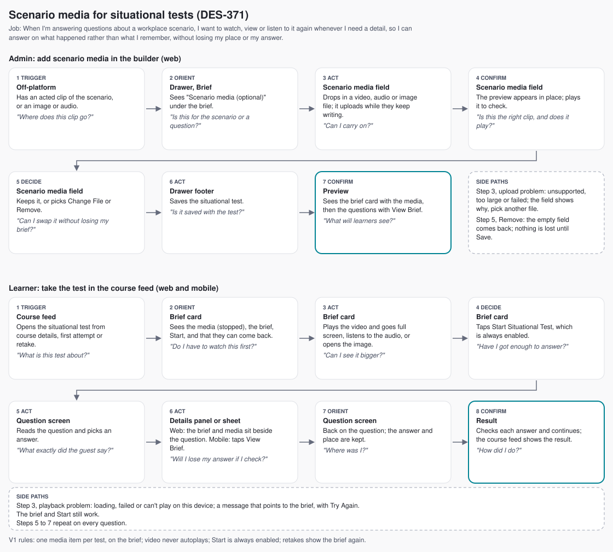

# DES-371: Scenario media for situational tests

Status: In Design Phase · Owner: Bruno Carvalho · Type: New Task · Priority: Medium · Supporting research: `2026-11-24-DES-371-situational-test-scenario-media.research.md`

---

## 1. Context

### The problem

A customer (raised on a commercial team call, received positively) wants a situational test that sets up its scenario with an acted video. Today the scenario is text only, and once learners start answering, the brief disappears: they answer questions about a situation they can no longer check. V1 attaches one scenario media item (image, audio or video) to the test and keeps it one tap away from every question.

Media in assessments is table stakes (TalentLMS, iSpring, Blackboard and others attach media per question). What is less common is the shape we chose: one scenario clip that sets up the whole test and stays reachable from each question. eduMe is the closest match, but uses video as answer feedback rather than as the set-up. Articulate Rise users ask for exactly this ("revisit scenario details before making a choice") and Rise can't do it.

### What the code does today

| Area | File / component | Today |
|---|---|---|
| Authoring drawer | `src/pages/your-courses/components/SituationalTestDrawer/SituationalTestDrawer.tsx` (`SituationalTestDrawerContent`, `SituationalTestData`, `snapshot`) | Opens from the course builder (`/create-course` > Course Content > Add Content > Situational Tests), not course details. Create is two steps: step 1 has the brief guidance callout, Title and Brief, then "Save & Add Questions"; step 2 adds questions. Edit and AI review use a `ContentSwitcher` with "Brief" and "Questions (n)" panes. `SituationalTestData` is `{ id, title, brief, questions }`; no media. "Preview" exists only on the AI review path. |
| Per-question media | Stash `stash@{0}` "DES-371: per-question QuestionMedia component" | Prototyped and pulled (phase 0, done). Kept for a later phase; its `FileUploader` upload modal and `Slider`-based audio player (`QuestionAudioPlayer`) can be reused for the scenario field. |
| Learner screens | `src/pages/your-courses/components/SituationalTestPreview/SituationalTestPreview.tsx` | Admin preview in `ConfirmModal` + `DesktopPreview` (600 x 812). Screen 0 is the brief card "as the course feed draws it" (Figma 17024:82020): illustration, title, brief, "Start Situational Test". Then one screen per question with `QuizHeader` and the quiz-lab renderers. Screens remount, so nothing persists between them. |
| Quiz chrome | `src/pages/quiz-lab/components/QuizHeader.tsx`, `FeedbackFooter.tsx`, `formats/*` | `QuizHeader` has a label, attempt count and close; no slot for another control. |
| Web learner feed | `src/pages/for-you/ForYou.tsx`, `components/LessonFeed.tsx` (`/for-you`) | The For You lesson feed, a different surface from the course feed. Lessons only; the "video" is a still image. The course feed itself (Figma "Course Feed V2", 17024:73838) opens from course details (`/courses/:id`, `src/pages/courses/ProgramCourseDetails.tsx`) and is not built. |
| Mobile app | `src/pages/mobile/CourseScreen.tsx`, `LessonFeedScreen.tsx`, `PhoneFrame` (`/mobile`) | Course screen lists `MobileAssessmentCard`s with no `onClick`; nothing opens a situational test. Lesson feed plays still images. |
| Shared components | `FileUploader`, `ConfirmModal` (`closable`), `BottomSheet`, `CloseButton` (`fullscreen`), `Slider`, `Button`, `Tooltip`, `Toast` | All exist. `Slider` has no doc of its own. No video player, audio player, full-screen viewer or admin media preview component or doc. |

### Decisions taken

| Decision | Why |
|---|---|
| One scenario media item per test, attached to the brief: image, audio or video | Matches the customer demo; the media is the scenario |
| Per-question media is out of V1 and removed from the prototype (phase 0, done; stashed for later) | One place for media; per-question media is a later phase |
| No forced viewing; "Start Situational Test" is always enabled | The questions check understanding; forcing hurts retakes and accessibility and adds hidden state. Research found no evidence against this (see Research); proof of viewing could later be a per-test admin setting |
| On web, the course feed's details panel shows the test's title, media and brief beside every question; no separate control. On mobile, a "View Brief" control on every question screen opens them in a bottom sheet. Either way the answer is kept and the media keeps its position | The web panel is already in the Course Feed V2 Figma and built (Bruno, 2026-11-24); mobile has no room for it. Meets AC4. "View Brief" matches the card's "Brief" label (UX audit) |
| No reassurance line on the brief card ("You can come back to this from any question." was added after the UX audit, then removed) | Bruno, 2026-11-24: the card stays as the Figma draws it |
| The brief is the fallback when media can't play: admins are told to write it to stand on its own, and failure messages point to it | Start stays enabled on failure and captions are out of scope (UX audit) |
| One media slot rule: fixed maximum height, media fitted, never cropped | A vertical clip must not push the brief or Start below the fold (UX audit) |
| The full-test Preview shows on create and edit, not only AI review | Admins on the manual path must see what learners get (UX audit) |
| The result screen and retake flow belong to the course feed, not this ticket | Already designed in the Course Feed V2 Figma |
| "Attach Media" under the Brief opens a list of three kinds, each reusing its Your Content pattern: Video (upload, or paste a link), Image (upload, generate with AI, stock footage), Audio (upload). Still one media item per test; preview, Change Media and Remove in place | Bruno, 2026-11-24, replacing the single upload field: the admin picks the kind first and gets the options that kind has |
| A pasted video link plays in its provider's own player (YouTube, Loom, Vimeo); the 5Mins controls and the remembered position apply to uploaded video only | Confirmed by Bruno, 2026-11-24 |
| The video progress bar shows progress only; no scrubbing. Moving through a clip is the 10 second skips. No three-dots menu on the player | Bruno, 2026-11-24 |
| Video can go full screen from the brief and from the overlay | AC3 |
| Video never autoplays; it shows stopped, on its first frame | Bruno's call; also avoids WCAG 1.4.2 issues |
| Retakes show the brief again | Bruno's call |
| AI-drafted tests get media after generation, through the same field on the review drawer's Brief pane | Bruno's call; generation never produces media |
| Captions come from the existing production player | Already exists; out of scope |
| Formats, size and length use common limits: image JPG, PNG, WebP up to 10MB; audio MP3, M4A, WAV up to 50MB; video MP4 up to 500MB and 5 minutes | Bruno's call (2026-11-24) |
| The video player is the production player (Video.js): big play button, play and pause, mute and volume, current time and duration, progress bar, captions menu, picture-in-picture, full screen | Reference shared by Bruno (2026-11-24); nothing new to design for video |
| Other components: match the Figma to an existing design system component first; build from the Figma only where there is none | Bruno's call (2026-11-24) |
| Mobile is portrait by default; landscape already works | No new work |

Rejected: a "View Brief" modal on web (the feed's details panel already keeps the brief beside the question); an inline collapsible card on each question (an expanded video pushes the question below the fold); separate media tabs (an extra control and ambiguity about which tab counts); per-question media in V1 (a different feature that doubles the states).

### The user journey

**Job:** When I'm answering questions about a workplace scenario, I want to watch, view or listen to it again whenever I need a detail, so I can answer on what happened rather than what I remember, without losing my place or my answer.

Claude Design: https://claude.ai/artifact/UdH2YqUvsrtFihgD9qBr9F

**Admin journey** (course builder > Add Content > Situational Tests drawer, web)

1. **Trigger** - off-platform: the admin has an acted clip of the scenario (from the customer's team or a production partner). *"Where does this clip go so learners see it with the scenario?"*
2. **Orient** - drawer, Brief (step 1 on create, the Brief pane on edit and AI review): sees "Scenario media (optional)" under the Brief, with the accepted types and size in the hint. *"Is this the scenario, or does it go on a question?"*
3. **Act** - drags in an MP4 (or picks a file); the zone shows Uploading with a percentage while the admin keeps editing the brief; the commit button is disabled until the upload completes. *"Is it uploading, and can I carry on?"*
   - Branch, unsupported file or too large: the zone shows Error with the reason and the accepted types; the admin picks another file.
   - Branch, upload fails: Error "Upload failed. Check your connection and try again."; the admin drops the file again.
4. **Confirm** - same field: the zone is replaced by an in-place preview (video stopped on its first frame with play and full screen; audio player; or the image), with file name and length. The admin plays it to check. *"Is this the right clip, and does it play?"*
5. **Decide** - same field: "Change File" or "Remove". A failed change keeps the current media. Removing puts the empty zone back; nothing is lost until the drawer is saved, and the drawer's existing unsaved-changes guard covers closing. *"Can I swap it without losing my brief?"*
6. **Act** - "Save & Add Questions" (create), "Update Situational Test" (edit) or "Save Situational Test" (AI review). *"Is it saved with the test?"*
7. **Confirm** - "Preview" (on create, edit and AI review) shows the brief card with the media, then the questions with the View Brief control. *"What will learners see?"*

**Learner journey** (course feed, web and mobile)

1. **Trigger** - opens the situational test from course details, or the course feed reaches it (first attempt or a retake). *"What is this test about?"*
2. **Orient** - brief card: title, the media (video stopped with a play button; audio player; or image), the brief text, and "Start Situational Test". *"Do I have to watch this first?"*
3. **Act** - plays the video, goes full screen and back, or listens to the audio, or taps the image to see it full screen. *"Can I see it bigger or hear that again?"*
   - Branch, loading: the media slot shows a loading state; the brief text and Start stay usable.
   - Branch, playback fails: in-place message that points to the brief, with "Try Again"; the brief stays readable and Start stays enabled.
   - Branch, unsupported on this device: in-place message saying it can't play here and that the brief describes the situation; Start stays enabled.
4. **Decide** - taps "Start Situational Test", which is always enabled. *"Have I got enough to answer?"*
5. **Act** - question screen: reads the question and picks an answer. *"What exactly did the guest say?"*
6. **Act** - web: looks across to the details panel, which shows the title, the media at the position it was left, and the brief (the panel toggle reopens it if closed). Mobile: taps "View Brief" in the question header, which opens the same content in a bottom sheet. Plays, scrubs, or goes full screen. *"Will I lose my answer if I check?"*
7. **Orient** - web: the question never left the screen. Mobile: closes the sheet (close, scrim or drag down); the media pauses and keeps its position; the question is as it was, answer still selected, focus back on "View Brief". *"Where was I?"*
8. **Confirm** - checks the answer, sees feedback, continues; steps 5 to 7 repeat on every question; the result screen at the end comes from the course feed. *"How did I do?"*

### Acceptance criteria

1. Admin flows cover adding, previewing, replacing, and removing each media type.
2. Learner flows cover image, audio, and video on both web and mobile, alongside situation context and questions.
3. Video playback includes a full-screen interaction.
4. Designs explain how a learner can revisit media while answering without losing their place.

### Out of scope

Per-question media (later phase, component stashed); more than one media item per test; forced viewing or proof of viewing; captions and transcripts (production player); trimming, cropping or editing media; showing the media on the admin answers page (`AssessmentAnswers.tsx`); media on other assessment types; landscape-specific layouts.

---

## 2. Research

Full notes, sources and screenshots in the research file. Prior art informs the design; it never overrides the 5Mins design system, token rules or copy skill.

### Where scenario media sits and how learners return to it

| Source | What it does | Verdict |
|---|---|---|
| [eduMe, scenario videos](https://help.edume.com/adding-scenario-videos) | Video is feedback shown after an answer; the learner can go back and re-answer | Reject placement; our video sets the scenario up |
| [Articulate Rise community](https://community.articulate.com/discussions/rise-360/rise-revisit-scenario-details-before-making-a-choice) (403; title only), [no video in Scenario block](https://community.articulate.com/discussions/rise-360/embedding-mp4-in-rise-360-s-scenario), [no resume position](https://community.articulate.com/discussions/rise-360/allow-a-storyline-block-to-retain-it-s-resume-position-when-revisiting-a-lesson) | Users ask to revisit scenario details; Rise can't embed video in scenarios or keep answers and position | Adopt the need; keep answer and position (AC4) |
| [TalentLMS, media in test questions](https://help.talentlms.com/hc/en-us/articles/360014659873-How-to-add-audio-or-video-to-test-questions) | Per question, via iframe HTML; "not a straightforward one" | Reject: per-question and awkward |
| [iSpring QuizMaker media](https://www.ispringsolutions.com/docs/x/AIge) | Media per question slide with "controls" and "autoplay" options | Reject autoplay; controls always on |
| [Sana, learner assessments](https://help.sana.ai/en/articles/100288-learner-assessments) | Free back and forth between questions; nothing about media in assessments | Nothing useful on media |

### Forced viewing (validating the decision)

| Source | What it does | Verdict |
|---|---|---|
| [Sana, video block](https://help.sana.ai/en/articles/7490-the-video-block) | A video can be set mandatory ("watch the entire video before moving onto the next card"); off unless set | Supports default off; proof of viewing as a later opt-in |
| [Ausmed, prevent skipping ahead](https://knowledge.organisations.ausmed.com.au/en/knowledge/how-to-prevent-skipping-ahead-of-videos-for-assigned-learning) | Blocks forward scrubbing on the first watch only; free afterwards | Supports free revisits |
| [Articulate, forcing users to watch](https://community.articulate.com/discussions/discuss/forcing-users-to-watch-majority-or-entire-video-clip/707549/replies/1251908) | Learners minimise and wait; advice: agree "retention is the goal, not forced viewing" | Supports no forcing |
| [Docebo community, video completion](https://community.docebo.com/product-q-a-7/video-completion-dilemma-8455) | Scrub tracking proves nothing was watched; conflicts with accessibility | Supports no forcing |

**Result:** prior art supports the decision. Forcing exists in the market only as an opt-in, and nothing found contradicts "off by default". No empirical study either way was found; the case against forcing is practitioner experience, not data.

### Playback, accessibility and formats

| Source | What it does | Verdict |
|---|---|---|
| [WCAG 2.2, 1.4.2 Audio Control](https://www.w3.org/WAI/WCAG22/Understanding/audio-control), [2.2.2 Pause, Stop, Hide](https://www.w3.org/WAI/WCAG22/Understanding/pause-stop-hide), [axe no-autoplay](https://dequeuniversity.com/rules/axe/4.8/no-autoplay-audio) | Autoplaying sound needs a pause; moving content needs a pause | Adopt: no autoplay, visible pause |
| [WCAG 2.2, 2.1.1 Keyboard](https://www.w3.org/WAI/WCAG22/Understanding/keyboard) | Every control works by keyboard | Adopt: play, scrub, full screen, View Brief, overlay close |
| [MDN video codecs](https://developer.mozilla.org/docs/Web/Media/Formats/Video_codecs), [Sana video block](https://help.sana.ai/en/articles/7490-the-video-block) | H.264 MP4 has the widest support; Sana accepts MP4 only | Adopt MP4 as the default |
| [eduMe, scenario video recommendations](https://help.edume.com/scenario-video-recommendations) | Portrait 9:16, first person, about 2 minutes, under 25MB recommended (80MB cap) | Adopt as admin guidance; limits to confirm |

### Mobbin

| Screen | What it shows | Verdict |
|---|---|---|
| [YouTube, sheet under video](https://mobbin.com/screens/509b5353-f619-47d5-92fa-25c6f2aa8759) | Full-screen icon on the player; video keeps its position while a sheet is open | Adopt full-screen control and kept position |
| [Liven, sheet over paused video](https://mobbin.com/screens/5f3f2686-9e1d-42c3-a594-3366accc039c) | Video pauses under a sheet; 10s back/forward | Adopt pause-when-covered and 10s rewind |
| [Matter, sheet over reading](https://mobbin.com/screens/3762e7f0-1b4c-4182-b6e8-1a112542e325) | Reference opens as an overlay, source still behind | Adopt overlay, not navigation away |
| [Noom, context inside quiz card](https://mobbin.com/screens/1e72c86b-e88f-4407-8fd5-f60146d6cf6a) | Context inline above options | Reject for video (rejected inline card) |
| [Upwork, project video](https://mobbin.com/screens/5c9749d8-6da9-4cca-8e74-85573ac2bcab) | Limits in the helper ("(.mp4), up to 100MB"), playable preview, change and delete | Adopt limits in the hint and a playable preview |
| [Squarespace, lesson video](https://mobbin.com/screens/8ab83cf6-6568-42e8-b81c-083eb2caaccf) | Preview, file name and length, Replace and trash below | Adopt layout of the filled field |
| [Patreon, uploading](https://mobbin.com/screens/03822e19-93e2-4334-a828-d105ccf9fba8) | "Uploading 51%" while the form stays editable | Adopt |
| [Finch, error loading video](https://mobbin.com/screens/eaebf4be-46a2-4769-b6d9-189dd755756e) | Error in place, rest of the flow usable | Adopt: failure never blocks Start |
| [Prime Video, network error](https://mobbin.com/screens/7f93f562-2680-4876-9cc2-c11898ae4092) | Full-screen error | Reject: keep errors in the media slot |
| [MasterClass, audio](https://mobbin.com/screens/09572f38-4886-446b-8b15-fa19d50d7772) | Scrubber with times, 10s back, play/pause, 10s forward | Adopt; matches the stashed `QuestionAudioPlayer` |

### Build For Mars

| Lesson | Principle | Verdict |
|---|---|---|
| [Context Shifting](https://builtformars.com/ux-glossary/context-shifting) | Every switch costs attention; people lose their place | Adopt: overlay over the question, answer and position kept |
| [Pausing the video](https://builtformars.com/ux-bites/pausing-the-video) | Pause automatically when another layer takes over | Adopt: closing the overlay pauses |
| [Did you miss what they said?](https://builtformars.com/ux-bites/did-you-miss-what-they-said) | 10s rewind is the "what did they say" control | Adopt 10s rewind; subtitle trick belongs to the production player |
| [Show, Don't Tell](https://builtformars.com/cheatsheets/6-onboarding-rules) | Show only what is needed; don't block people who know | Supports always-enabled Start |

Sources with nothing useful: Docebo (no docs on test media; only an 800MB upload cap in the community), Cornerstone and Workday Learning (no scenario media found), Sana on media inside assessments.

---

## 3. Implementation

### Blockers

1. **No course feed in the prototype (blocks the learner side: AC2, the learner part of AC3, AC4).** The course feed is designed (Figma "Course Feed V2", 17024:73838) and opens from course details, but nothing is built: `/for-you` `LessonFeed` is a different surface, and on mobile `CourseScreen` passes no `onClick` to its `MobileAssessmentCard`s. Recommendation: build only the feed's first phase before this feature's learner work: one seeded situational test opened from course details on web (`/courses/:id/feed`) and on mobile, with the brief card and question screens moved out of `SituationalTestPreview` into one shared player, so the admin Preview, the web feed and the mobile feed draw the same copy and this ticket adds media to it once. The feed plan is drafted and waiting on Bruno's decisions (entry point, question header, component references).
2. **Missing DS components and docs (blocks Phases 3 to 6; each renders a player).** **Video player: resolved.** It is the production Video.js player, with the controls listed in Decisions taken; the prototype needs a stand-in that shows the same controls. Still missing or undocumented: audio player (the stashed `QuestionAudioPlayer` is built on DS parts but undocumented; `Slider` has no doc), full-screen image viewer, the admin filled-field preview with Change File and Remove, and a slot in the question header for "View Brief". At 375px the header has about 80px free and the new control would sit beside the exit; the feed's Figma header ("Question 1/10" with hearts) also differs from today's `QuizHeader`. Recommendation: look for the audio player and image viewer in the Figma files first, and design the question header with "View Brief" in Figma. Nothing here is designed from scratch in code. Only Phase 1 can be built before this is resolved.
3. **Media pipeline (production). Limits settled for design.** Upload, transcoding, storage, poster frame and streaming stay engineering decisions. The design uses common limits: image JPG, PNG, WebP up to 10MB; audio MP3, M4A, WAV up to 50MB; video MP4 (H.264) up to 500MB and 5 minutes, with admin guidance "about 2 minutes" (eduMe). MOV and WebM accepted only if engineering transcodes. Does not block the prototype.

### Phases

| # | Change | Verifies | AC | Step |
|---|---|---|---|---|
| 0 | **Remove per-question media. Done.** `QuestionMedia`, `allowMedia`, `SituationalQuestion.media` and the quiz-lab rendering reverted; component stashed as `stash@{0}` for the later phase and for reuse in Phase 4. | `pnpm build` passes; no "Attach Media" row on any question | - | - |
| 1 | **Data. Done 2026-11-24.** Add `media?: { kind: 'image' \| 'audio' \| 'video'; src; name; duration? }` to `SituationalTestData`; include it in `snapshot()` so adding, changing or removing it makes the drawer dirty. Mock one test with an acted video, one with audio, one with an image. | Dirty guard fires after removing media; saved test keeps it | AC1 | A3-A6 |
| 2 | **Resolve Blocker 2.** Figma references for the video player, audio player and image viewer; the mobile question header with "View Brief" designed in Figma; the media slot rule written into the player spec: fixed maximum height, media fitted, never cropped, so a 9:16 clip never pushes the brief or Start below the fold. | References linked in this PRD; header fits at 375px without truncating | AC2, AC3 | L2-L7 |
| 3 | **Learner components. Built 2026-11-24 in the shared player and the feed (not yet "View Brief" in the admin Preview, nor Preview on create and edit).** In `SituationalTestPreview` (or the shared player, if the feed slice has landed): the brief card shows the media between the title and the brief Video stopped on its first frame with a centred play, a full-screen control (`aria-label` "Full screen" / "Exit full screen"), 10 second rewind; audio player; image opens full screen on click. "Start Situational Test" always enabled. On web, the feed's details panel (`cf-panel` in `CourseFeed.tsx`) shows the test title, the media, then the brief on every question, on every format and also on text-only tests; it already shows the title and brief. The admin Preview has no panel, so it gets the "View Brief" control and the mobile sheet (Phase 6). The "Preview" button shows on create and edit as well as AI review (one condition in the drawer footer). **Player rules:** closing the overlay pauses the media and keeps its position; the position is kept across questions; Start pauses anything playing, so no audio carries into question 1; a clip that has ended reopens stopped at the start; a retake starts the media from the beginning. **Answer kept:** the question screen does not remount when the overlay opens, for selected options, free text and drag formats alike. Escape leaves full screen first, then closes the modal; focus returns to "View Brief". **States:** loading (poster and spinner, "Loading video..."), playback failure ("This video can't play right now. The brief below describes the situation." + "Try Again"), unsupported ("This video can't play on this device. The brief below describes the situation."), with audio and image versions of the same lines; in every state the brief text and Start stay usable. | Preview from a manually created test: answer on Q2 (option, then free text, then a drag format) > View Brief > play to 0:40 > close: answer intact; reopen on Q3: video at 0:40, stopped; Start while audio plays: silence on Q1; keyboard reaches every control | AC1, AC3, AC4 | A7, L2-L7 |
| 4 | **Admin field. Built 2026-11-24.** Under Brief in step 1, the edit Brief pane and the AI review Brief pane: label "Scenario media" with hint "(optional)", helper "An image, audio or video clip that shows the situation. Learners can return to it from every question. Write the brief so it works on its own if the clip can't play.", and `FileUploader` L with `helpText` "Drag and drop an image, audio or video file, or click to upload" and the limits hint "(Image up to 10MB • audio up to 50MB • MP4 video up to 500MB)". The guidance callout gains one bullet: "The brief should describe the situation even without the media". Type detected from the file. Errors in the zone, per type: "This file type isn't supported. Use JPG, PNG, WebP, MP3, M4A, WAV or MP4.", "This image is over 10MB. Choose a smaller file." (and the audio and video versions), "Upload failed. Check your connection and try again." Filled: the zone is replaced by the preview (same players and slot rule as Phase 3), file name and length, a "Change File" text button and a "Remove" icon button with `Tooltip` "Remove media" (icon turns `--text-error` on hover). Swap animates with `AnimatePresence`. **Upload rules:** the brief stays editable while uploading; the commit button is disabled until the upload completes; an upload in progress counts as an unsaved change; a failed "Change File" keeps the current media. Remove needs no dialog; nothing is committed until Save. **States:** no media, uploading, error (type, size per type, failed), attached per type. | Each type adds, plays, changes and removes; a .pdf shows the type error; a 20MB image shows the image size error; closing mid-upload triggers the unsaved guard; Save keeps the media on reopen | AC1 | A2-A6 |
| 5 | **Feed slice, web and mobile (Blocker 1; the course feed's first phase). Done 2026-11-24, without media.** Seeded situational test on the learner course; opens from course details on web (`/courses/:id/feed`) and from `MobileAssessmentCard` on mobile; brief, questions, back to the course; reopening starts at the brief. The Phase 3 components arrive through the shared player. | Web and `/mobile`: open the test, play the media, Start, View Brief on Q2 with the answer kept | AC2-AC4 | L1-L7 |
| 6 | **Mobile overlay. Built 2026-11-24; "View Brief" is a small text button beside the question counter, away from the close.** In `PhoneFrame` (dark only), "View Brief" opens a `BottomSheet` (overlays.md: drag, scrim tap, Escape to close; `hidden` keeps position) holding the title, media and brief; full screen uses the device player and rotates freely. Same rules and states as Phase 3. No tooltips on mobile. | Same check as Phase 3 on `/mobile`; dragging the sheet down pauses the video | AC2-AC4 | L5-L7 |
| 7 | **Figma flows.** Admin: empty, uploading, each error, filled per type, change, remove. Learner web and mobile: brief card per type, full-screen video, question with View Brief, overlay open, overlay closed with answer kept, loading, failure, unsupported. Light and dark sections (mobile dark only), callouts per the figma-conventions skill. | Figma audit script passes | All | All |

The result screen (L8) and retakes are part of the course feed (its results phase: score card, Retake, Review Answers), not this ticket. Until that phase lands, the test ends on the last question's feedback and retakes can't be verified end to end.

Components, all existing and documented unless noted: `FileUploader` (file-uploader.md), `ConfirmModal` with `closable` and `SectionHeader` (confirm-modal.md, overlays.md, headers.md), `BottomSheet` (overlays.md, mobile.md), `CloseButton` (overlays.md), `Button` (buttons.md), `Tooltip` (alerts-toast.md), motion per motion.md. Not documented: video player, audio player, `Slider`, full-screen image viewer, filled media preview, question header slot (Blocker 2).

### Risks to watch

- **Proof of viewing.** Compliance buyers may ask for evidence the clip was watched. Keep it as a later per-test setting; don't add tracking UI now.
- **Two overlays deep on web.** Full screen from inside the modal stacks two layers, and the admin Preview adds more; Escape order (full screen, then modal) must be tested with keyboard and screen reader.
- **Mobile data and load time.** A 500MB clip on a frontline worker's phone is slow. The admin helper should steer to short clips; engineering to confirm streaming and a poster frame.
- **Remove is one click.** A removed file may have taken minutes to upload. It is recoverable until Save (close without saving), so no dialog for now; revisit if testing shows accidental removals.
- **Stashed code drift.** The stashed `QuestionMedia` will drift from main; reuse it in Phase 4 soon or rebuild from it deliberately.

### UX audit

**Verdict: ready after plan fixes** (pre-build review, 2026-11-24; full audit in `2026-11-24-DES-371-situational-test-scenario-media.ux-audit.md`).

| Flow | Score |
|---|---|
| Admin: attach, check, change, remove | 7/10 |
| Admin: confirm what learners see | 4/10 |
| Learner: brief card | 6/10 |
| Learner: question, overlay and back | 7/10 |
| Learner: result | 3/10 |
| Implementation plan | 5/10 |

Changes made to the plan as a result (all 11 recommendations taken): the brief card says learners can come back; the control is "View Brief", matching the card's "Brief" label (was "Scenario"); the brief is the stated fallback when media can't play, in the admin helper, the guidance callout and the failure copy; limits copy is per type; the drawer's location is corrected to the course builder; three upload rules added; player rules and wider "answer kept" checks added; Preview shows on create and edit; one media slot rule (fixed maximum height, fitted, never cropped); the question header is designed in Figma before build; phases reordered around the blockers, with the feed slice as a real phase. The result screen moved to the course feed's plan. The journey diagram was updated in both places.

### Still open

Whether the audio player and image viewer exist in the Figma files (Blocker 2); the mobile question header design with "View Brief" (Blocker 2); how far to build the course feed beyond its first phase.
